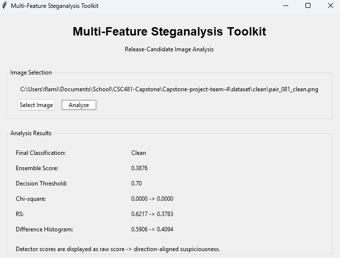
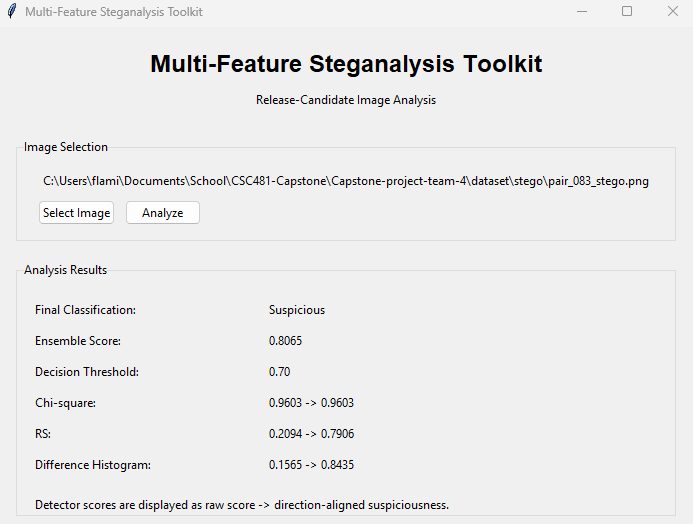
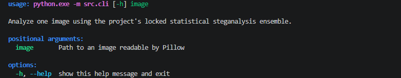
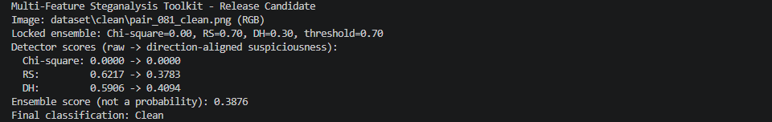
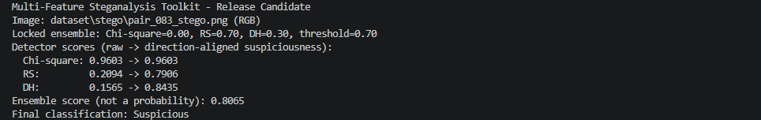

# Team Project: Multi-Feature Steganalysis Toolkit

A non-machine-learning image steganalysis toolkit that combines **Chi-square analysis,**
**RS analysis, and Difference Histogram (DH) analysis** to identify statistical evidence 
associated with Least Significant Bit (LSB) steganography.

The project was developed as a cybersecurity capstone by a three-member team. Individual
detector, dataset, evaluation, ensemble, testing, and documentation contributions were
integrated into a single statistical steganalysis pipeline.

The current project is a **release candidate** with a command-line interface for analyzing
one image at a time.

---

## Project Purpose

Steganography hides information inside another file, such as an image, in a way intended to
conceal the existence of the hidden information.

This toolkit focuses primarily on detecting statistical changes that may be introduced by
**LSB image steganography**.

Rather than relying on machine learning, the project uses three statistical detectors:

- **Chi-square analysis**
- **RS analysis**
- **Difference Histogram analysis**

The detector outputs are direction-aligned and combined through a weighted ensemble to produce a final:

```
Clean
```
or:
```
Suspicious
```
classification.

A `Suspicious` result represents statistical evidence associated with the tested steganography method.
It is **not proof** that an image contains hidden information.

---

## Features 

The current toolkit provides:

- Chi-square LSB steganalysis
- RS regular/singular analysis
- Difference Histogram analysis
- Grayscale and RGB image processing
- Direction-aligned detector scores
- Weighted ensemble classification
- Locked validation-selected detector weights
- Reproducible randomized-LSB dataset generation
- Development, validation, and held-out evaluation splits
- ROC/AUC and confusion-matrix evaluation
- Payload-rate robustness analysis
- Automated testing
- Release-candidate command-line interface
- User-facing Clean/Suspicious results
- Concise command-line error handling

---

## Statistical Detectors

### Chi-square

The Chi-square detector examines paired pixel-value frequencies for statistical behavior associated with
LSB replacement.

The detector produces a bounded score based on its Chi-square p-value.

The current release candidate still reports the Chi-square result for diagnostic purposes, although the
locked final ensemble gives it a weight of `0.00`.

### RS Analysis

RS analysis separates image samples into groups and examines how local pixel variation changes when
Least Significant Bits are flipped.

Groups are categorized as:

- Regular
- Singular
- Unchanged

The resulting bounded RS score is direction-aligned before ensemble voting so that a higher normalized
score represents greater suspiciousness.

### Difference Histogram

Difference Histogram analysis measures differences between horizontally and vertically adjacent pixels.

For each image channel, the detector:

1. Calculates adjacent-pixel differences.
2. Builds a 511-bin histogram representing differences from `-255` through `+255`.
3. Examines variation in the central portion of the histogram.
4. Calculates a bounded DH score.
5. Direction-aligns the score so that a higher normalized value represents greater suspiciousness.

Grayscale images are analyzed as one channel.

RGB images are analyzed across the red, green, and blue channels.

---

### Ensemble Classification

The release candidate uses the configuration selected during validation and locked before held-out testing.

| Detector | Weight |
| --- | ---: |
| Chi-square | `0.00` |
| RS | `0.70` |
| Difference Histogram | `0.30` |

The locked decision threshold is:

```
0.70
```

The ensemble classification rule is:

```
ensemble score >= 0.70
         ↓
     Suspicious

ensemble score < 0.70
         ↓
       Clean
```

The ensemble score is a statistical decision score and **is not a probability** that an image contains hidden
information.

---

## Requirements

The project requires Python 3 and the packages listed in `requirements.txt`.

Current dependencies include:

```
numpy>=2.0
Pillow>=10.0
scipy>=1.12
pytest>=8.0
matplotlib>=3.11.2
scikit-learn>=1.9.1
```

---

## Installation

Clone the repository:

```
git clone https://github.com/Menishen100/Capstone-project-team-4.git
cd Capstone-project-team-4
```

Create a virtual environment:

```
python -m venv .venv
```

### Windows PowerShell

Activate it with:

```
.\.venv\Scripts\Activate.ps1
```

### macOS/Linux

Activate it with:

```
source .venv/bin/activate
```

Install the required packages:

```
pip install -r requirements.txt
```

Run commands from the repository root so Python can correctly locate the `src` package and project files.

---

## Running the CLI

Analyze one image with:

```
python -m src.cli path/to/image.png
```

Alternatively, the CLI can be run directly with:

```
python src/cli.py path/to/image.png
```

For example:

```
python -m src.cli dataset/clean/pair_081_clean.png
```

The CLI runs the image through:

```
Image
  ↓
Preprocessing
  ↓
Chi-square
RS Analysis
Difference Histogram
  ↓
Direction Alignment
  ↓
Locked Weighted Ensemble
  ↓
Clean / Suspicious
```

The CLI reuses the project's existing detector, normalization, and voting implementations.

It does not create a separate scoring formula or recalibrate the system.

---

## GUI

The toolkit also provides an optional graphical user interface for analyzing images.

Launch the GUI from the repository root with:

```
python -m src.gui
```

The GUI allows the user to:

- Select an image from the computer
- Run the existing steganalysis pipeline
- View the final Clean or Suspicious classification
- View the ensemble score
- View the decision threshold
- Review the Chi-square, RS, and Difference Histogram scores

Detector results are displayed as:

```
raw score -> direction-aligned suspiciousness
```

The GUI uses the same existing analysis pipeline as the command-line interface and does not implement separate detector, normalization, or ensemble logic.

### GUI Example Results

A known clean held-out image:

```
dataset/clean/pair_081_clean.png
```

produced:



A known randomized-LSB stego held-out image:

```
dataset/stego/pair_083_stego.png
```

produced:



---

## CLI Help

Display command-line help with:

```
python -m src.cli --help
```



---

## Example Clean Analysis

A known clean held-out image can be analyzed with:

```
python -m src.cli dataset/clean/pair_081_clean.png
```

This image was correctly classified by the locked pipeline as:

```
Clean
```

Its held-out ensemble score is approximately:

```
0.3876
```

which is below the locked `0.70` threshold.



---

## Example Suspicious Analysis

A known stego held-out image can be analyzed with:

```
python -m src.cli dataset/stego/pair_083_stego.png
```

This image was correctly classified by the locked pipeline as:

```
Suspicious
```

Its held-out ensemble score is approximately:

```
0.8065
```

which is above the locked `0.70` threshold.



---

## Understanding CLI Output

A successful analysis produces output similar to:

```
Multi-Feature Steganalysis Toolkit - Release Candidate

Image: path/to/image.png (RGB)

Locked ensemble: Chi-square=0.00, RS=0.70, DH=0.30, threshold=0.70

Detector scores (raw -> direction-aligned suspiciousness):
  Chi-square: 0.xxxx -> 0.xxxx
  RS: 0.xxxx -> 0.xxxx
  DH: 0.xxxx -> 0.xxxx

Ensemble score (not a probability): 0.xxxx
Final classification: Clean
```

or:
```
Final classification: Suspicious
```

### Raw Detector Score

The first number shown for each detector is the bounded score returned directly by that detector.

### Direction-Aligned Suspiciousness

The second number is the score after the project's normalization rules align detector direction.

After direction alignment:

```
higher value = more suspicious
```

This allows detectors with different raw score meanings to be combined consistently.

### Ensemble Score

The ensemble score is calculated from the normalized detector values using the locked detector weights.

It is not a probability.

### Final Classification

A score below `0.70` produces:

```
Clean
```

A score equal to or above `0.70` produces:

```
Suspicious
```

---

## Interpreting Results

### Clean

`Clean` means that the ensemble score did not reach the project's suspiciousness threshold.

It does **not** guarantee that the image contains no hidden information.

### Suspicious

`Suspicious` means that the statistical detector evidence caused the ensemble score to meet or exceed the threshold.

It does **not** prove that the image contains hidden information.

A clean image can occasionally produce statistical patterns that appear suspicious, and a low-payload stego
image may not produce enough statistical evidence to cross the threshold.

---

## Supported Images

The release-candidate CLI accepts image files that can be opened by Pillow.

Images already in:

```
L
RGB
```

mode retain their existing representation.

Other Pillow-readable image modes follow the project's preprocessing rule and are converted to RGB before
detector analysis.

The preprocessing pipeline does **not** resize, filter, normalize, or otherwise intentionally modify the
image's pixel values before statistical analysis.

### Dataset-Generation Restriction

The project's randomized-LSB dataset generator is more restrictive than the analysis CLI.

Dataset generation expects:

- PNG images
-  Grayscale (`L`) or RGB mode

This restriction helps preserve lossless image data during controlled LSB experiments.

---

## Project Dataset

The primary experimental dataset contains:

```
100 clean images
100 randomized-LSB stego images
```

Each clean image has a paired stego counterpart.

The primary experiment uses:

```
256 x 256 pixels
PNG format
Grayscale or RGB
0.25 randomized-LSB payload rate
```

Reproducible random seeds are recorded in the dataset metadata.

The 100 source-image pairs are divided into:

| Source IDs | Split | Pairs | Images |
| --- | --- | ---: | ---: |
| `001-060` | Development | 60 | 120 |
| `061-080` | Validation | 20 | 40 |
| `081-100` | Held-out test | 20 | 40 |

Dataset metadata is stored in:

```
data/metadata.csv
```

The metadata records information such as:

- source ID
- clean filename
- stego filename
- payload rate
- random seed
- color mode
- dimensions
- experimental split
- image format
- generation status
- embedding statistics
- source/license information

---

## Evaluation Methodology

The project separates detector development, ensemble calibration, and final evaluation.

### Development

Sources `001-060` were used for detector development and preliminary scoring.

### Validation

Sources `061-080` were used when evaluating candidate ensemble weights and decision thresholds.

The selected validation configuration was:

```
Chi-square weight = 0.00
RS weight = 0.70
DH weight = 0.30
Threshold = 0.70
```

Validation performance for the selected configuration was:

| Metric | Result |
| --- | ---: |
| Accuracy | `75.00%` |
| Precision | `72.73%` |
| Recall | `80.00%` |
| F1 | `76.19%` |

The configuration was locked before evaluating the held-out test split.

### Held-Out Test

Sources `081-100` formed the held-out test set.

The held-out evaluation contained:

```
20 clean images
20 stego images
40 total images
```

The final confusion-matrix counts were:

| | Predicted Clean | Predicted Suspicious |
| --- | ---: | ---: |
| Actual Clean | TN = `16` | FP = `4` |
| Actual Stego | FN = `11` | TP = `9` |

The corresponding held-out AUC results were:

| Scores | AUC |
| --- | ---: |
| Chi-square | `0.5475` |
| RS | `0.6850` |
| Difference Histogram | `0.5875` |
| Ensemble | `0.6675` |

These values describe performance on this specific held-out dataset and should not be treated as universal
steganalysis accuracy.

---

## Payload-Rate Robustness

A separate controlled experiment evaluated how the locked ensemble behaved as randomized-LSB payload increased.

The tested payload rates were:
```
0.10
0.25
0.50
0.75
1.00
```

Twenty source images were embedded at each payload rate, producing:

```
20 source images x 5 payload rates
= 100 experimental stego images
```

The observed stego detection rates were:

| Payload Rate | Detected Stego | Detection Rate |
| --- | ---: | ---: |
| `0.10` | 5 / 20 | `25%` |
| `0.25` | 9 / 20 | `45%` |
| `0.50` | 15 / 20 | `75%` |
| `0.75` | 20 / 20 | `100%` |
| `1.00` | 20 / 20 | `100%` |

These percentages are **stego detection rates**, not overall classification accuracy, because every image in
this experiment contained an LSB payload.

The experiment demonstrates that lower-payload randomized LSB steganography was more difficult for the locked
ensemble to detect than higher-payload steganography.

---

## Known Limitations

This toolkit has important limitations.

- It is a **statistical, non-machine-learning** steganalysis system.
- It is designed primarily around detection of randomized LSB replacement behavior.
- It does not guarantee detection of every steganography algorithm.
- Lower-payload steganography can be substantially more difficult to detect.
- Some clean images can naturally exhibit statistical patterns that produce suspicious detector scores.
- A `Suspicious` classification should not be treated as proof that hidden information exists.
- A `Clean` classification should not be treated as proof that hidden information does not exist.
- Detector and ensemble performance depends on image content, preprocessing assumptions, embedding technique,
  payload rate, and the evaluated dataset.
- The ensemble score is a detection score, not a calibrated probability.
- The current locked ensemble assigns Chi-square a weight of `0.00`; its score is still reported for analysis
  and diagnostic visibility.

The toolkit should therefore be used as a statistical analysis aid rather than as a universal steganography detector.

---

## Testing

Automated tests are stored in:

```
tests/
```

Run the project test suite from the repository root with:

```
python -m pytest -v
```

Focused tests are also available for individual detector, ensemble, evaluation, plotting, payload-robustness,
and integration components.

Testing is intended to verify behavior such as:

- detector score ranges
- grayscale and RGB handling
- preprocessing behavior
- normalization
- weighted voting
- threshold behavior
- dataset generation
- evaluation calculations
- plotting utilities
- payload robustness
- CLI integration and error handling

---

## Repository Structure

```
Capstone-project-team-4/
|
|-- data/
|   |-- metadata.csv
|   |-- evaluation CSV files
|   |-- payload-robustness results
|
|-- dataset/
|   |-- clean/
|   |-- stego/
|
|-- docs/
|   |-- evaluation documentation
|   |-- assets/
|
|-- slides/
|
|-- src/
|   |-- cli.py
|   |-- preprocessing.py
|   |-- lsb_embedder.py
|   |
|   |-- detectors/
|   |   |-- chi_square.py
|   |   |-- rs_analysis.py
|   |   |-- difference_histogram.py
|   |
|   |-- ensemble/
|   |   |-- normalization.py
|   |   |-- voting.py
|   |
|   |-- evaluation/
|       |-- scoring, calibration, held-out evaluation, plotting,
            error analysis, and robustness scripts
|
|-- tests/
|
|-- requirements.txt
|-- README.md
```

---

## Project Workflow

The completed project pipeline can be summarized as:

```
Clean source images
         ↓
Randomized LSB embedding
         ↓
Clean / stego paired dataset
         ↓
Preprocessing
         ↓
┌───────────────────────────────┐
│ Chi-square                    │
│ RS Analysis                   │
│ Difference Histogram          │
└───────────────────────────────┘
         ↓
Direction-aligned scores
         ↓
Locked weighted ensemble
         ↓
Decision threshold
         ↓
Clean / Suspicious
         ↓
Evaluation and visual evidence
         ↓
Release-candidate CLI
```

## Team

### Afriyie Menishen — Team Lead

Primary project contributions include team coordination, ensemble development and calibration, integration,
held-out evaluation, and release-candidate CLI integration.

### Arthur Coleman — Team Member A

Primary technical contributions include Chi-square and RS detector development, detector validation, quality assurance,
and regression/integration verification.

### Exzavier Pickering — Team Member B

Primary technical contributions include Difference Histogram development, evaluation visualization,
ROC/AUC and confusion-matrix evidence, payload-rate robustness analysis, error analysis, and user-facing release documentation.

---

## Project Status

The toolkit has progressed from individual detector prototypes into an integrated **release-candidate statistical steganalysis system**.

At the current stage, the repository includes:

- paired experimental dataset generation
- all three statistical detectors
- shared preprocessing
- score normalization
- weighted ensemble voting
- locked validation-selected configuration
- held-out evaluation
- ROC/AUC and confusion-matrix evidence
- payload-rate robustness testing
- automated tests
- release-candidate command-line interface
- user documentation and visual workflow evidence

Future improvements could investigate additional steganography techniques, alternative statistical features,
broader datasets, improved low-payload detection, and optional graphical user-interface support.
