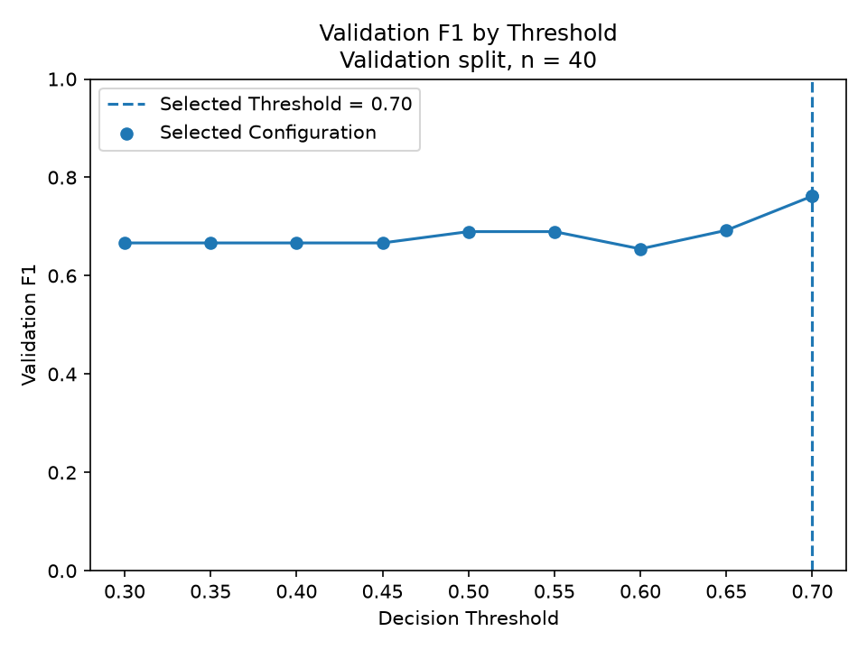
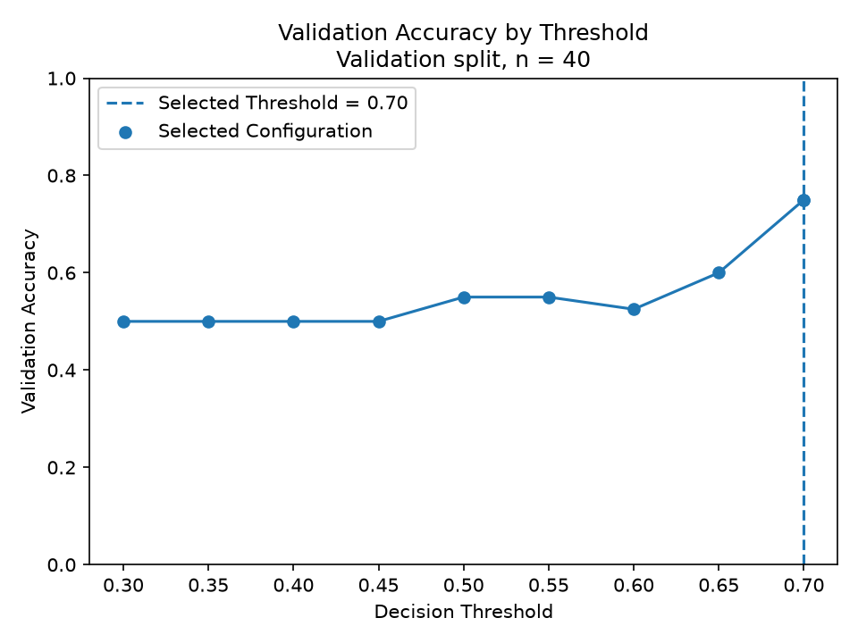
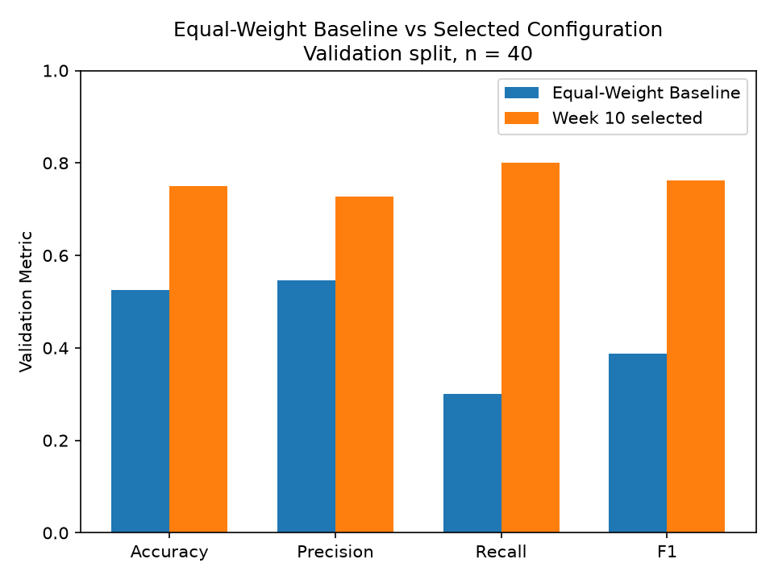
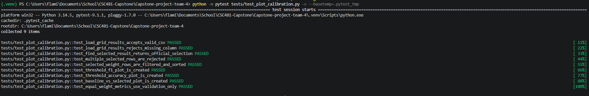

# Week 10 Validation Calibration Plots and Baseline Comparison

## 1. Purpose

Use the completed Week 10 grid-search results to create validation plots that
show how the selected ensemble configuration performs.

This contribution does not perform another grid search or select new weights
and thresholds.

The purpose is to visually display:

- Validation F1 across thresholds,
- Validation accuracy across thresholds,
- Equal-weight baseline compared with the selected configuration.

The held-out test split is not used because it remains reserved for Week 11.

## 2. Grid-search plotting input

`src/evaluation/plot_calibration.py` reads the completed Week 10 grid-search
results from:

`data/week10_grid_search_results.csv`

The plotting program checks that the required columns exist before generating
the plots.

Required plotting columns include:

- `selected`
- `chi_weight`
- `rs_weight`
- `dh_weight`
- `threshold`
- `validation_accuracy`
- `validation_precision`
- `validation_recall`
- `validation_f1`
- `validation_rows`

The program finds the configuration already marked as selected instead of
choosing a new configuration itself.

## 3. Selected Week 10 configuration

The official Week 10 grid search selected:

| Setting | Selected Value |
| --- | ---: |
| Chi-square weight | 0.00 |
| RS weight | 0.70 |
| DH weight | 0.30 |
| Threshold | 0.70 |

The validation split contains `40` images.

The plotting program does not change these values.

## 4. Validation F1 by threshold

The first plot shows how validation F1 changes across the tested decision
thresholds while keeping the selected detector weights the same.

The selected weights remain:

```
Chi-square = 0.00
RS = 0.70
DH = 0.30
```

The plot uses:

```
X-axis = Decision Threshold
Y-axis = Validation F1
```

The selected threshold of `0.70` is marked on the graph.



The F1 values stay similar across several lower thresholds before increasing at
the selected threshold.

At threshold `0.70`, the selected configuration has a validation F1 of: 

`0.7619`

The graph supports the grid-search results but does not independently select the
threshold.

## 5. Validation accuracy by threshold

The second plot shows how validation accuracy changes across the same threshold
values.

The selected detector weights remain unchanged.

The plot uses:

```
X-axis = Decision Threshold
Y-axis = Validation Accuracy
```



Validation accuracy remains around `0.50` across several lower thresholds before
increasing at the higher thresholds.

At the selected threshold of `0.70`, validation accuracy reaches:

`0.7500`

Validation F1 remains the official grid-search selection metric. Accuracy is
used as supporting validation evidence.

## 6. Equal-weight baseline comparison

The third plot compares the existing equal-weight ensemble baseline with the
official Week 10 selected configuration.

The existing equal-weight baseline uses:

```text
Chi-square = 1/3
RS = 1/3
DH = 1/3
Threshold = 0.50
```

The comparison uses:

- Accuracy,
- Precision,
- Recall,
- F1.



The selected Week 10 configuration reports:

| Metric | Validation Result |
| --- | ---: |
| Accuracy | 0.7500 |
| Precision | 0.7273 |
| Recall | 0.8000 |
| F1 | 0.7619 |

The selected configuration performs higher than the existing equal-weight
baseline across the four displayed validation metrics.

This comparison does not perform another search. The baseline is only used as
a reference to show the difference between the original equal-weight ensemble
and the selected Week 10 configuration.

## 7. Equal-weight baseline evaluation

The exact equal-weight configuration is not included in the Week 10 grid
because the weight grid uses increments of `0.10`.

Equal weighting requires approximately:

```
0.3333
0.3333
0.3333
```

Instead of changing Menishen's grid-search code,
`calculate_equal_weight_validation_metrics()` uses the already existing
`EQUAL_WEIGHT_BASELINE`.

The function:

1. Gets the existing calibration detector scores,
2. Keeps only rows where `split == "validation"`,
3. Applies the equal-weight ensemble,
4. Converts the ensemble output into clean/stego predictions,
5. Calculates accuracy, precision, recall, and F1.

The program also checks that the baseline and selected configuration use the
same number of validation images before creating the comparison plot.

## 8. Held-out protection

The held-out test split is not used during Week 10 plotting.

The calibration scoring process is restricted to `development` and `validation`

The equal-weight baseline calculation further keeps only:

```
split == "validation"
```

The plotting program does not calculate held-out:

- Accuracy,
- Precision,
- Recall,
- F1,
- ROC,
- AUC,
- Confusion matrix.

The held-out test split remains unchanged for Week 11.

## 9. Tests

`tests/test_plot_calibration.py` covers:

- Valid grid-search results being accepted,
- Missing required plotting columns being rejected,
- Official selected configuration being found,
- Multiple selected configurations being rejected,
- Selected weight rows being filtered correctly,
- Threshold rows being sorted correctly,
- Validation F1 plot being created,
- Validation accuracy plot being created,
- Baseline comparison plot being created,
- Equal-weight metrics using validation records only.

Run the plotting tests with:

```
python -m pytest tests/test_plot_calibration.py -v --basetemp=.pytest_tmp
```

The tests use temporary grid-search data instead of modifying the real Week 10
results.

The validation-only test also confirms that development and held-out records do
not enter the equal-weight metric calculation.



## 10. Limitations

The plots display validation results only and do not represent final project
performance.

This contribution does not:

- Select new weights,
- Select a new threshold,
- Modify detector algorithms,
- Perform another grid search,
- Tune the configuration based on the graphs,
- Use held-out test results,
- Produce final project accuracy,
- Generate final ROC/AUC results.

The plots are used to visually support the Week 10 calibration results.

## 11. Work deferred to Week 11

The selected Week 10 configuration remains unchanged for later held-out
evaluation. Week 11 will use the locked configuration for the final held-out test and later
performance evaluation.

No final held-out performance is reported in this Week 10 contribution.