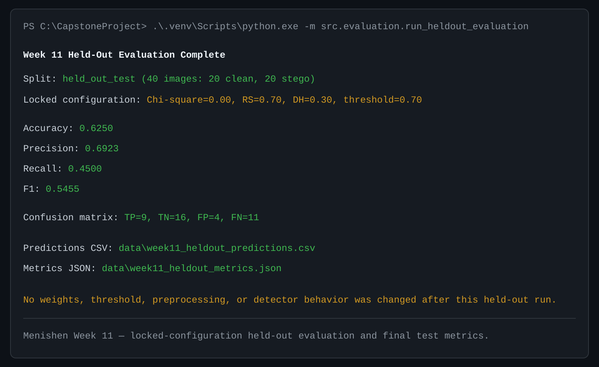

# Week 11 Held-Out Evaluation — Menishen

## Scope and lock rule

This is the official Week 11 held-out evaluation. It uses only the 20 source
pairs whose metadata has `split=held_out_test`: 20 clean images and 20 matched
stego images, for 40 images total.

The Week 10 configuration was locked before this run and was not changed after
the held-out results were observed:

| Setting | Locked value |
| --- | ---: |
| Chi-square weight | 0.00 |
| RS weight | 0.70 |
| Difference Histogram weight | 0.30 |
| Decision threshold | 0.70 |

`src/evaluation/run_heldout_evaluation.py` uses the existing Week 9 ensemble
normalization and voting boundary. It does not conduct a grid search, adjust a
weight or threshold, modify detector behavior, alter preprocessing, or include
development/validation rows.

## Official command

```powershell
.venv\Scripts\python.exe -m src.evaluation.run_heldout_evaluation `
  --predictions data\week11_heldout_predictions.csv `
  --metrics data\week11_heldout_metrics.json
```

The runner refuses to overwrite either output file. This prevents an
accidental second official held-out run with the same output paths.

## Final held-out results

| Metric | Result |
| --- | ---: |
| Accuracy | 0.6250 |
| Precision | 0.6923 |
| Recall | 0.4500 |
| F1 | 0.5455 |

| Confusion-matrix count | Result |
| --- | ---: |
| True positive (TP) | 9 |
| True negative (TN) | 16 |
| False positive (FP) | 4 |
| False negative (FN) | 11 |

These results are recorded exactly as observed. The lower recall and the
resulting false negatives are findings for the later error-analysis work; they
are not grounds to change the locked Week 10 configuration.

## Output artifacts

- [Per-image held-out predictions](../data/week11_heldout_predictions.csv)
- [Held-out metrics and locked configuration](../data/week11_heldout_metrics.json)

The prediction CSV records the source identifier, true label, filename, raw
detector scores, Week 9 direction-aligned scores, ensemble score, prediction,
and correctness for each of the 40 images.

## Tests

`tests/test_heldout_evaluation.py` uses temporary images and metadata; it does
not read, score, or rewrite the official held-out outputs. It tests:

- the locked Week 10 weights and threshold;
- reading only held-out metadata rows;
- expected source-pair count enforcement;
- use of the official ensemble boundary;
- required prediction fields;
- final accuracy, precision, recall, F1, TP, TN, FP, and FN calculations;
- rejection of non-held-out rows; and
- refusal to overwrite official result paths.

Focused Week 11 and locked-configuration tests passed: **34 passed**.
The complete repository suite passed: **226 passed**.



*Figure 1. Menishen Week 11 — locked-configuration held-out evaluation and
final test metrics. The command used 40 held-out images and did not change
weights, threshold, score direction, preprocessing, or detector behavior.*

## Work handed to the other Week 11 roles

Arthur can independently verify the immutable prediction CSV and metrics JSON,
including the confusion-matrix counts and configuration. Exzavier can use the
same per-image continuous scores for the required held-out ROC/AUC and
confusion-matrix visualizations. Neither activity should re-tune the locked
configuration.
