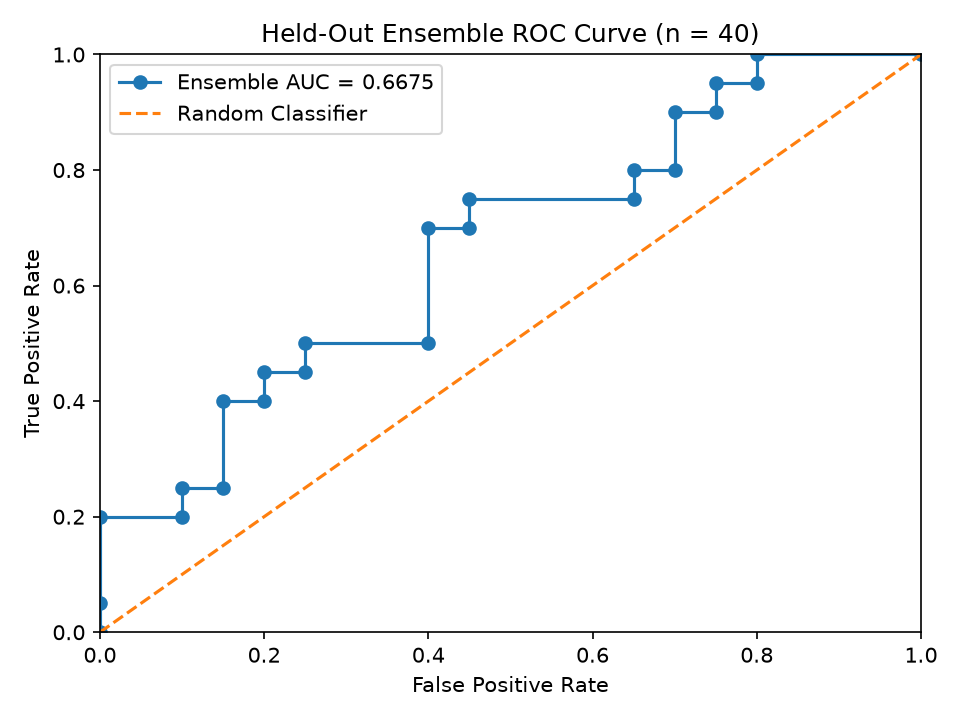
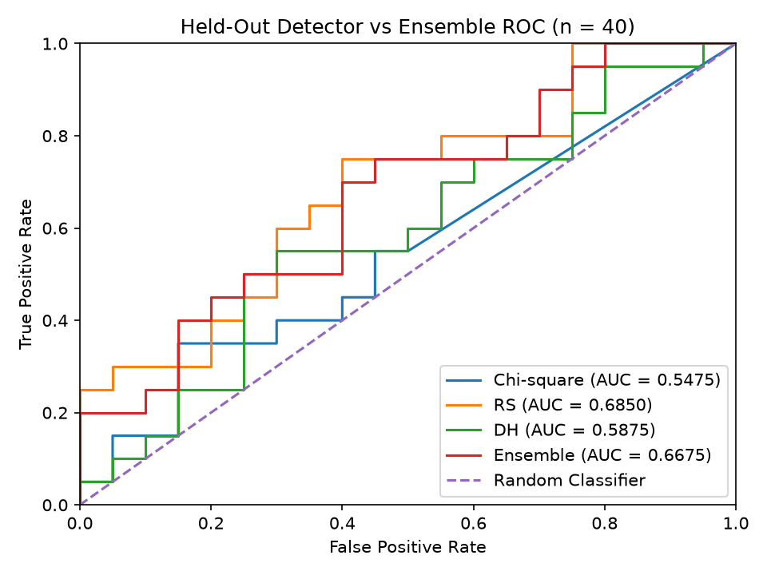
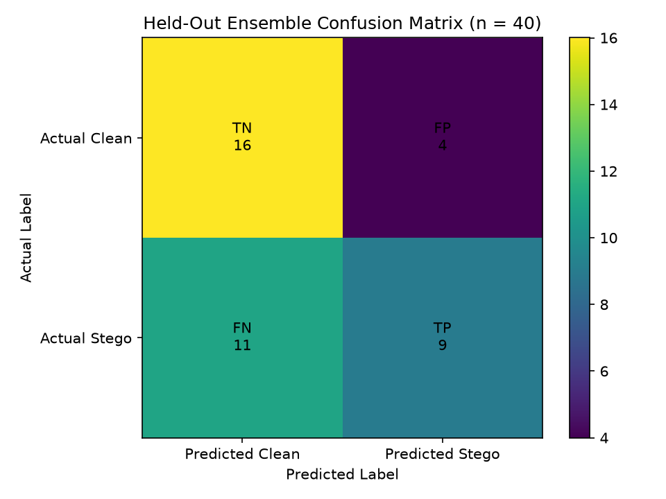
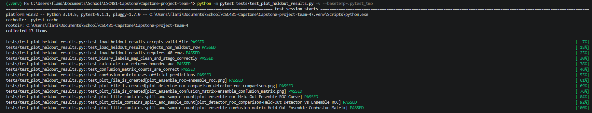

# Exzavier - Week 11 Held-Out ROC/AUC and Confusion-Matrix Plots

## Scope and locked configuration

This is Exzavier's Week 11 held-out evaluation-visualization contribution. It
uses Menishen's official Week 11 held-out prediction output to produce ROC/AUC
and confusion-matrix visualizations for the final locked ensemble.

The primary evaluation input is:

`data/week11_heldout_predictions.csv`

The held-out split contains `40` images.

The configuration was locked at the end of Week 10:

| **Setting** | **Locked value** |
| --- | ---: |
| Chi-square weight | 0.00 |
| RS weight | 0.70 |
| Difference Histogram weight | 0.30 |
| Decision threshold | 0.70 |

The Week 11 plotting workflow does not change these weights or select a new
threshold after seeing held-out results.

## Plotting workflow

The plotting utility is:

`src/evaluation/plot_heldout_results.py`

The script loads Menishen's official held-out prediction table and verifies
that:

- Exactly `40` rows are present;
- Every row belongs to `held_out_test`;
- Clean/stego labels are valid;
- Clean/stego predictions are valid;
- Both clean and stego examples are present;
- Normalized detector scores are numeric, finite, and within `[0, 1]`; and
- Ensemble scores are numeric, finite, and within `[0, 1]`.

For ROC/AUC evaluation, `clean` is treated as the negative class and `stego`
as the positive class:

```
clean = 0
stego = 1
```

The individual detector ROC curves use the Week 9 direction-aligned scores:

```
normalized_chi
normalized_rs
normalized_dh
```

The ensemble ROC curve uses: `ensemble_score`

The confusion matrix uses Menishen's official `prediction` column rather than
recalculating predictions or selecting another threshold.

## Ensemble ROC curve

The first plot shows the held-out ROC curve for the locked ensemble.

- X-axis: false positive rate
- Y-axis: true positive rate
- Split: held-out test
- Sample size: `n = 40`
- Ensemble AUC: `0.6675`



The ROC curve evaluates the continuous ensemble suspiciousness score across
possible evaluation thresholds.

The calculated held-out ensemble AUC is: `0.6675`

The ROC thresholds are used only to measure ranking behavior. They do not
replace or retune the locked Week 10 decision threshold of `0.70`.

## Detector vs ensemble ROC comparison

The second plot compares the held-out ROC curves for Chi-square, RS, Difference
Histogram, and the locked ensemble using the same `40` held-out images.



The calculated held-out AUC values are:

| **Score** | **Held-out AUC** |
| --- | ---: |
| Chi-square | 0.5475 |
| RS | 0.6850 |
| Difference Histogram | 0.5875 |
| Ensemble | 0.6675 |

RS has the highest AUC of the four plotted scores on this held-out dataset,
followed by the ensemble.

This result is reported as evaluation evidence only. The ensemble weights are
not changed because the configuration was locked before the held-out results
were examined.

## Ensemble confusion matrix

The third plot shows the final classification results from Menishen's official
held-out predictions.



The confusion-matrix counts are:

| | **Predicted Clean** | **Predicted Stego** |
| --- | ---: | ---: |
| **Actual Clean** | TN = 16 | FP = 4 |
| **Actual Stego** | FN = 11 | TP = 9 |

The counts total the complete held-out set:

```
16 + 4 + 11 + 9 = 40
```

The actual clean rows also total `20`:

```
TN + FP
16 + 4 = 20
```

The actual stego rows total `20`:

```
FN + TP
11 + 9 = 20
```

The confusion matrix uses the official binary predictions from the held-out
results file. It does not create new predictions from the ROC curve or choose
a different decision threshold.

## ROC/AUC and confusion-matrix calculation

`calculate_roc()` converts the clean/stego ground-truth labels into binary
values and uses the requested continuous score column to calculate:

- false positive rate;
- true positive rate;
- ROC thresholds; and
- AUC.

The same function is reused for:

```
normalized_chi
normalized_rs
normalized_dh
ensemble_score
```

`calculate_confusion_matrix()` compares the true held-out labels with the
official `prediction` column.

With `clean = 0` and `stego = 1`, the matrix positions are:

```
TN  FP
FN  TP
```

This produces the final held-out counts of:

```
TN = 16
FP = 4
FN = 11
TP = 9
```

## Held-out evaluation protection

Unlike Week 10, Week 11 is the scheduled point where the held-out split is
evaluated.

The plotting workflow accepts only rows where:

`split == "held_out_test"`

Validation and development rows are rejected by the Week 11 input validation.

The plotting code does not:

- Search for new ensemble weights;
- Choose a new threshold from the ROC curve;
- Use Youden's J to replace the locked threshold;
- Change detector algorithms; or
- Modify predictions after seeing the held-out results.

The locked Week 10 configuration remains unchanged throughout the Week 11
visualization process.

## Plot generation and verification

The Week 11 plotting tests are located in:

`tests/test_plot_heldout_results.py`

The tests cover:

- Loading a valid `40`-row held-out result file;
- Rejecting rows that are not from `held_out_test`;
- Rejecting an incorrect held-out row count;
- Converting clean/stego labels to binary ROC labels correctly;
- Confirming AUC remains within `[0, 1]`;
- Confirming ROC arrays are produced;
- Verifying TN, FP, FN, and TP positions;
- Confirming confusion-matrix counts total the number of evaluated images;
- Confirming the official prediction column is used instead of recalculating
  Predictions from scores;
- Creating the ensemble ROC plot;
- Creating the detector-versus-ensemble ROC plot;
- Creating the ensemble confusion-matrix plot; and
- Confirming the plots contain held-out split and sample-count information.

Run the focused plotting tests from the repository root:

```
python -m pytest tests/test_plot_heldout_results.py -v --basetemp=.pytest_tmp
```

The tests use synthetic temporary rows so the official Week 11 held-out result
file is not modified.

The generated Week 11 plots are stored in:

```
docs/assets/week11-progress/
    ensemble_roc.png
    detector_roc_comparison.png
    ensemble_confusion_matrix.png
```



## Held-out results summary

Running:

```
python -m src.evaluation.plot_heldout_results
```

Produced:

```
Held-Out rows: 40

AUC results:
Chi-square AUC: 0.5475
RS AUC: 0.6850
DH AUC: 0.5875
Ensemble AUC: 0.6675

Confusion matrix counts:
TN: 16
FP: 4
FN: 11
TP: 9
```

These results are based on the fixed held-out dataset and the configuration
locked at the end of Week 10.

## Work boundaries

This contribution provides the ROC/AUC and confusion-matrix visualization layer
for the Week 11 held-out evaluation.

Menishen's official held-out evaluation remains the source of the prediction
output and final team metrics table.

Arthur's independent metric and confusion-matrix verification remains a
separate Week 11 contribution.

No configuration changes are made from the visualizations, and no additional
held-out tuning is performed after these results are observed.