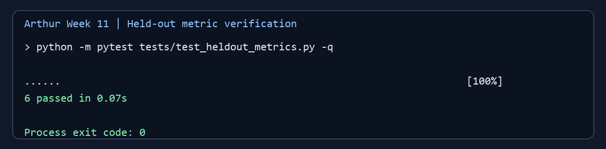

# Week 11 Team Progress Report

## Milestones

The team completed the planned Week 11 held-out evaluation, metric verification,
ROC/AUC plots, and confusion-matrix plot. The Week 10 configuration remained
locked at Chi-square 0.00, RS 0.70, DH 0.30, and threshold 0.70. Results were
reported as observed without retuning.

The official prediction file contains 40 rows (20 clean and 20 stego). Final
metrics are accuracy 0.6250, precision 0.6923, recall 0.4500, and F1 0.5455;
confusion counts are TP 9, TN 16, FP 4, and FN 11. Exzavier's ROC analysis
reports AUC 0.5475 for Chi-square, 0.6850 for RS, 0.5875 for DH, and 0.6675 for
the ensemble.

## Subtasks completed and test evidence

### Arthur — independent metric and confusion-matrix verification

Implemented `src/evaluation/heldout_metrics.py` to consume the official
prediction CSV and metrics JSON without loading images or rerunning detectors.
It checks exactly 20 unique held-out sources and 40 rows, the correct
clean/stego filenames for each paired source, the locked configuration, each
row's Week 9 normalized values and voting output, and recomputed accuracy,
precision, recall, F1, TP, TN, FP, and FN against the official summary.

The six focused tests cover:

1. A hand-calculated example with TP=1, TN=1, FP=1, FN=1 and accuracy,
   precision, recall, and F1 all equal to 0.5.
2. A 40-row synthetic fixture with 20 clean and 20 stego images, one per label
   for each source, checking locked weights, ensemble-score and prediction
   parity, metrics, and confusion counts.
3. Rejection of a source ID outside the held-out set.
4. Rejection of a changed threshold.
5. Rejection of an incorrect ensemble score.
6. Rejection of an incorrect confusion-matrix count.

`python -m pytest tests/test_heldout_metrics.py -q`: **6 passed**.
`python -m src.evaluation.heldout_metrics`: **passed** against the official
results. It independently reproduced TP=9, TN=16, FP=4, FN=11, accuracy
0.6250, precision 0.6923, recall 0.4500, and F1 0.5455. Confusion counts sum
to 40. The screenshot below records the focused test run; the full verification
output is documented in
[`week11-arthur-heldout-verification.md`](week11-arthur-heldout-verification.md).

### Menishen — official held-out evaluation

Menishen supplied `src/evaluation/run_heldout_evaluation.py`, the official
prediction CSV, and metrics JSON. The evaluation documentation reports 34
focused locked-configuration/evaluation tests and 226 full-suite tests passing.
Documented checks include held-out-only inputs, paired source counts, required
prediction fields, metrics and confusion calculations, and refusal to
overwrite official output paths. See
[`week11-heldout-evaluation.md`](week11-heldout-evaluation.md) and its embedded
terminal evidence screenshot.

### Exzavier — held-out ROC/AUC and confusion-matrix plots

Exzavier supplied `src/evaluation/plot_heldout_results.py`, the ensemble ROC,
detector comparison ROC, confusion-matrix plot, and plot documentation. The
documented tests cover held-out-only inputs, label mapping, AUC bounds,
confusion-matrix positions and totals, plot creation and split/sample metadata,
and the requirement that plotting does not tune the threshold. See
[`week11-heldout-plots.md`](week11-heldout-plots.md), which includes test
evidence and the three plots.

The documented held-out AUC results are:

| Score | AUC |
| --- | ---: |
| Chi-square | 0.5475 |
| RS | 0.6850 |
| Difference Histogram | 0.5875 |
| Ensemble | 0.6675 |

## Lessons learned

- Independent checks should use the official score normalization and voting
  code so they do not repeat earlier score-direction inconsistencies.
- Pair-level metadata checks complement image-row checks by confirming one
  clean and one stego image per held-out source.
- Synthetic tests validate arithmetic and safeguards; comparing against the
  official CSV and JSON confirms the actual reported test results.
- Lower held-out recall is a finding to document for later robustness work,
  not a reason to alter the already locked configuration.

## Team contributions

| Member | Week 11 contribution |
| --- | --- |
| Arthur | Implemented and tested the independent verifier, documented the checks, captured test evidence, and confirmed the official metrics and confusion counts. |
| Menishen | Ran the locked held-out evaluation and supplied the runner, predictions, summary metrics, tests, and evaluation documentation. |
| Exzavier | Produced the held-out ROC/AUC comparison and confusion-matrix plots, plot tests, and plot documentation. |

## Progress against plan

The team completed the Week 11 milestone as scheduled. The official runner,
metric verification, and plots all use the same 40-image held-out set. No plan
adjustment was needed. The Week 10 weights, threshold, score direction, and
detector behavior remain unchanged; the recorded held-out results are not used
to retune them.
