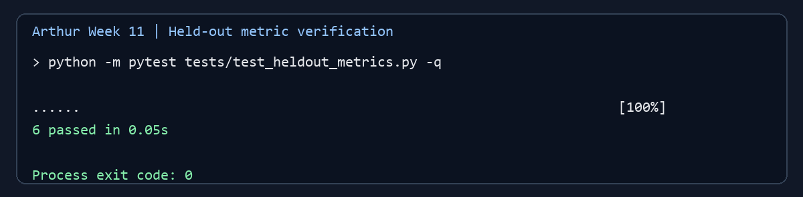

# Week 11 Team Progress Report

## Milestones

The project plan schedules Week 11 for a one-time held-out evaluation with
metrics, ROC/AUC, and confusion-matrix results. The Week 10 configuration is
locked at Chi-square 0.00, RS 0.70, DH 0.30, and threshold 0.70.

Arthur's independent metric-verification component is implemented and its
focused tests pass. The full team milestone is **partially achieved** in this
checkout: Menishen's official prediction/metrics files and Exzavier's held-out
plots are not present here, so final held-out results and visualizations cannot
yet be verified or reported. This status describes the shared project
workspace available for this report; it does not establish whether teammates
have work in another checkout.

## Subtasks completed and test evidence

### Arthur — independent held-out metrics and confusion-matrix verification

Implemented `src/evaluation/heldout_metrics.py` to consume the official
prediction CSV and metrics JSON, without loading images or rerunning detectors.
The verifier checks exactly 20 unique held-out sources and 40 image rows, one
clean and one stego row per source, labels and predictions, locked weights and
threshold, ensemble arithmetic and predictions using the repository's existing
metric/voting helpers, and recomputed accuracy, precision, recall, F1, TP, TN,
FP, and FN. It rejects result rows whose source IDs do not match held-out
metadata.

Added six focused tests in `tests/test_heldout_metrics.py`:

1. A hand-calculated case confirms TP=1, TN=1, FP=1, FN=1 and accuracy,
   precision, recall, and F1 all equal 0.5.
2. A 40-row synthetic fixture checks the expected 20/20 class balance, locked
   configuration, ensemble-score/prediction parity, metric values, and
   confusion counts.
3. A row from outside the held-out source set is rejected.
4. A changed threshold is rejected.
5. A changed ensemble score is rejected.
6. An incorrect reported confusion-matrix count is rejected.

Command: `python -m pytest tests/test_heldout_metrics.py -q`  
Result: **6 passed**. This is a synthetic unit-test fixture, not the official
held-out evaluation. The evidence image is included below.

Documentation and a repeatable evidence-capture script were added. The
verification command is documented in
[`week11-arthur-heldout-verification.md`](week11-arthur-heldout-verification.md).

### Menishen — official held-out evaluation

The assigned task is to run the locked configuration once and provide the
official per-image predictions and summary metrics. Those artifacts are not
present in this checkout, so the official run and its result cannot be
confirmed in this report.

### Exzavier — held-out plots

The assigned task is to create ensemble and detector ROC/AUC comparisons and a
confusion-matrix plot from the official held-out results. Those plot artifacts
are not present in this checkout, so plot completion cannot be confirmed here.

## Lessons learned

- Metric checks are most useful when they consume the official result file and
  reuse the project's voting convention; parallel interpretations can repeat
  earlier score-direction inconsistencies.
- Pair-level metadata should be checked alongside image-level rows. Requiring
  one clean and one stego row per held-out source catches split leakage and
  missing class members.
- Synthetic fixtures validate arithmetic and safeguards, but they cannot stand
  in for the official test-set result.

## Team contributions recorded from this checkout

| Member | Week 11 contribution visible in this checkout |
| --- | --- |
| Arthur | Added the held-out result verifier, six focused tests, verification documentation, and passing-test evidence. |
| Menishen | Assigned owner of the official held-out evaluation. Official output files were not available here for verification. |
| Exzavier | Assigned owner of ROC/AUC and confusion-matrix plots. Plot files were not available here for verification. |

The last two entries describe the evidence available in this checkout, not a
judgment about work performed elsewhere.

## Progress against plan and adjustment

Arthur's assigned verification work is complete at the unit-test level. The
team's full Week 11 milestone remains partial until the official results and
plots are integrated. Next, integrate Menishen's CSV and JSON, run
`python -m src.evaluation.heldout_metrics`, and attach the verification output.
Then check that Exzavier's plots use those same 40 held-out rows. Keep the
Week 10 weights, threshold, score direction, and detector behavior unchanged;
do not retune based on held-out results. If official artifacts are maintained
outside this checkout, bring them into the project branch before final
submission so the team report can record the actual results.
