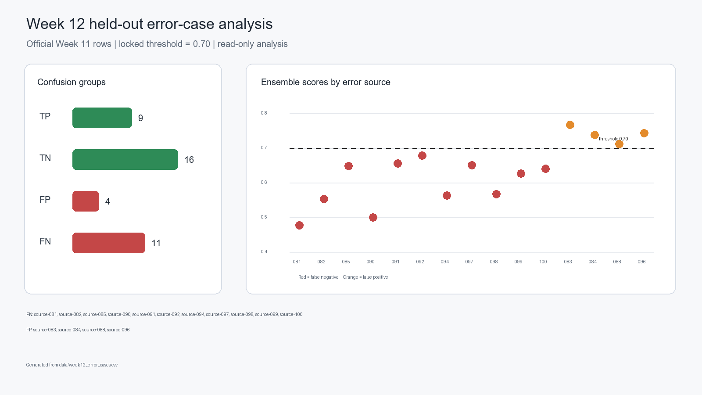

# Arthur Week 12 — Chi-square/RS Error Analysis

## Scope and safeguards

This analysis reads the official, locked Week 11 held-out predictions. It does
not load or rescore images. The configuration remains Chi-square 0.00, RS 0.70,
DH 0.30, and threshold 0.70; the Week 11 predictions and metrics are unchanged.
Chi-square remains useful as a diagnostic even though its ensemble weight is
zero. RS and DH normalized scores are the existing direction-aligned values.

## Frozen Week 11 error IDs

- **False negatives (11):** source-081, source-082, source-085, source-090,
  source-091, source-092, source-094, source-097, source-098, source-099,
  source-100.
- **False positives (4):** source-083, source-084, source-088, source-096.
- **True positives:** 9. **True negatives:** 16.

These are image-row outcomes. Every source has one clean and one stego image;
no source ID appears in both error lists. FP/FN are not duplicate image cases.

## Raw and normalized Chi-square/RS means by outcome

| Outcome | n | Mean Chi-square | Mean RS | Mean normalized Chi | Mean normalized RS |
|---|---:|---:|---:|---:|---:|
| TP | 9 | 0.2133 | 0.2408 | 0.2133 | 0.7592 |
| TN | 16 | 0.0625 | 0.4705 | 0.0625 | 0.5295 |
| FP | 4 | 0.2610 | 0.2761 | 0.2610 | 0.7239 |
| FN | 11 | 0.0941 | 0.4255 | 0.0941 | 0.5745 |

For false negatives, mean normalized RS suspiciousness is below the TP mean
(0.5745 versus 0.7592), while it remains above the TN mean (0.5295). This
indicates weaker RS suspiciousness on missed stego images, rather than RS
values being uniformly in the clean range. Chi-square averages 0.0941 on FNs,
but contributes **zero** to the locked ensemble. It is diagnostic only for this
configuration. The weighted ensemble is most influenced by RS (0.70 weight);
the available held-out outputs do not establish causal attribution beyond
these score comparisons.

FP mean normalized RS is 0.7239 and mean normalized DH is 0.7798, both high
relative to the TN means (0.5295 and 0.6351). Thus the four false positives
show elevated suspiciousness from both weighted detectors, rather than a
Chi-square-driven FP pattern.

## Threshold distance

The CSV records `ensemble_score - 0.70`; negative values are below threshold.
Six of 15 errors are within 0.05 of the threshold, and 10 of 15 are within
0.10. Among the 11 false negatives, two are within 0.05 and six are within
0.10. The remaining cases are farther from the decision boundary, including
source-081 (0.4784, distance -0.2216) and source-090 (0.4999, distance
-0.2001). Several false positives are close: source-088 is 0.0123 above
threshold. The errors therefore include both borderline and more substantial
misses.

## Source difficulty and payload questions

No source ID is repeated across the FP and FN lists. A broader claim that
particular source images are repeatedly difficult needs repeated payload or
condition measurements; the official Week 11 file has one clean/stego pair
per source and does not contain payload-rate variation. Payload-rate trends,
including low-payload degradation, require Exzavier's separate Week 12
robustness output and are not inferred here. Those experimental outputs must
not be presented as replacement held-out accuracy.

## Reproducibility and tests

Run the reusable analyzer and Arthur-specific means report from the repository
root:

```powershell
python -m src.evaluation.analyze_week12_errors
python -m src.evaluation.analyze_arthur_week12
python -m pytest tests/test_week12_error_analysis.py tests/test_week12_arthur_regression.py -q
```

`test_week12_arthur_regression.py` freezes the observed official FN/FP source
IDs, a known false-negative row's score, RS inversion, and Chi-square
normalization. These regression checks preserve Week 11 behavior; they do not
assert that an error should become correctly classified.

Evidence caption: **Arthur Week 12 – Chi-square/RS error analysis and
regression-test evidence.**



*Figure 1. Confusion-group counts, exact FN/FP source IDs, and official ensemble
scores against the locked 0.70 threshold.*
