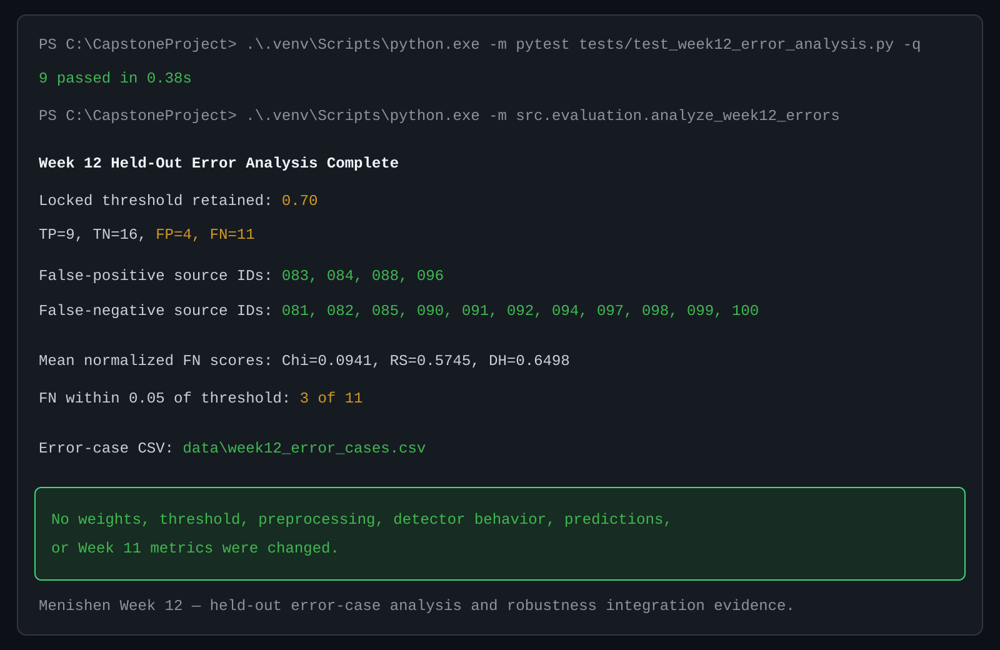

# Week 12 Held-Out Error Analysis — Afriyie Menishen

## Scope and safeguard

This is a descriptive analysis of the official Week 11 output,
`data/week11_heldout_predictions.csv`. It loads that completed 40-row
held-out table, classifies its existing results as TP, TN, FP, or FN, and
writes the derived FP/FN table `data/week12_error_cases.csv`.

It does **not** load images, rerun detectors, select new weights, choose a new
threshold, alter preprocessing, edit predictions, replace Week 11 metrics, or
remove difficult samples. The locked configuration remains Chi-square `0.00`,
RS `0.70`, DH `0.30`, with threshold `0.70`.

## Reproducible workflow

```powershell
.venv\Scripts\python.exe -m src.evaluation.analyze_week12_errors `
  --predictions data\week11_heldout_predictions.csv `
  --output data\week12_error_cases.csv
```

The script verifies that the source table contains exactly 40
`held_out_test` rows: 20 clean and 20 stego, with exactly one clean and one
stego row for every one of the 20 source IDs. It also checks that all detector,
normalized, and ensemble scores are finite values in `[0, 1]`.

## Observed error cases

The official Week 11 confusion matrix is preserved: TP `9`, TN `16`, FP `4`,
and FN `11`.

| Error type | Count | Source IDs |
| --- | ---: | --- |
| False positive | 4 | `source-083`, `source-084`, `source-088`, `source-096` |
| False negative | 11 | `source-081`, `source-082`, `source-085`, `source-090`, `source-091`, `source-092`, `source-094`, `source-097`, `source-098`, `source-099`, `source-100` |

Each row in [the derived error-case table](../data/week12_error_cases.csv)
records the source ID, actual label, official prediction, error type, raw
detector scores, direction-aligned scores, ensemble score, and the signed
threshold distance:

```text
distance_from_threshold = ensemble_score - 0.70
```

A negative value identifies an FN below the locked threshold; a positive value
identifies an FP above it.

## Threshold-distance findings

The 11 FNs range from `-0.2216` to `-0.0211` from the fixed threshold. Only
3 of 11 are within `0.05` of `0.70`; therefore, most FNs are not merely
near-boundary cases. The four FPs are `+0.0123` to `+0.0675` above the fixed
threshold, so they are all comparatively close to that boundary.

These observations describe the locked result only. They do not justify a
different Week 11 operating threshold.

## Detector-score comparison by observed case type

The following values are means of the Week 9 direction-aligned suspiciousness
scores in the official prediction CSV. Higher remains more suspicious.

| Case type | Rows | Chi-square | RS | DH |
| --- | ---: | ---: | ---: | ---: |
| True positive | 9 | 0.2133 | 0.7592 | 0.7433 |
| True negative | 16 | 0.0625 | 0.5295 | 0.6351 |
| False positive | 4 | 0.2610 | 0.7239 | 0.7798 |
| False negative | 11 | 0.0941 | 0.5745 | 0.6498 |

For FNs, DH has the highest mean direction-aligned detector score (`0.6498`),
but RS contributes more to the locked ensemble score because its fixed weight
is `0.70` versus DH's `0.30`. The FN RS mean (`0.5745`) is below the TP RS
mean (`0.7592`). Arthur's separate Week 12 detector review can investigate
that behavior without changing the detector formulas or score direction.

FPs have elevated mean RS (`0.7239`) and DH (`0.7798`) suspiciousness compared
with TNs (`0.5295` and `0.6351`). The source IDs occur once each in this
one-pair-per-source held-out set, so this analysis cannot claim that any source
image is repeatedly difficult. It identifies candidates for the planned error
analysis only.

## Payload-rate coordination boundary

Exzavier's separate Week 12 payload-rate robustness experiment will evaluate
new controlled samples at documented payload rates without overwriting the
official dataset. Once that work and Arthur's detector review are complete,
their descriptive findings can be combined with this error-case table in the
Week 12 team progress report. This document intentionally does not infer
payload-rate effects from the fixed `0.25` Week 11 dataset alone.

## Tests

```powershell
.venv\Scripts\python.exe -m pytest tests/test_week12_error_analysis.py -q -p no:cacheprovider
```

The nine focused tests cover complete paired held-out input validation, wrong
row count/split/score/source rejection, TP/TN/FP/FN assignment, signed
threshold-distance calculation, error-only CSV structure, detector-score
means, no-retuning summary language, invalid labels, and the exact official
Week 11 FP/FN source-ID populations.



*Figure 1. Menishen Week 12 — Held-out error-case analysis and robustness
integration evidence.*
