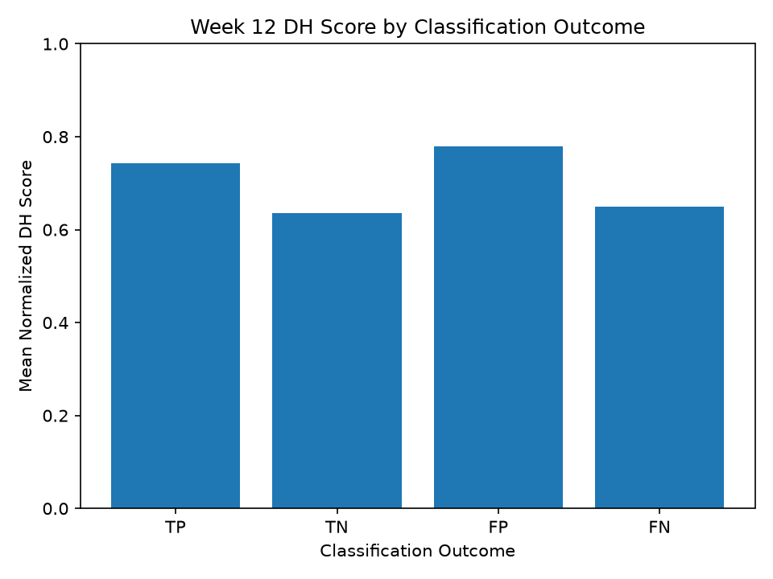
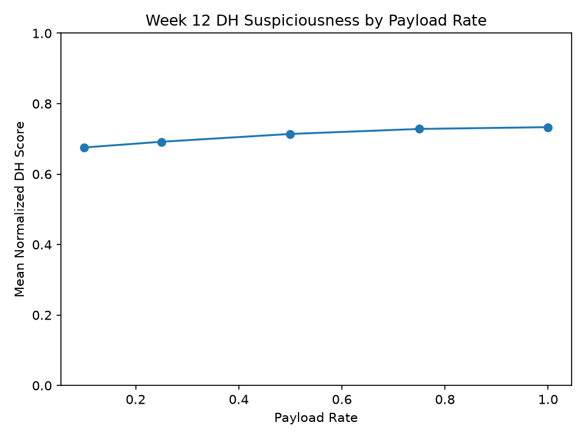
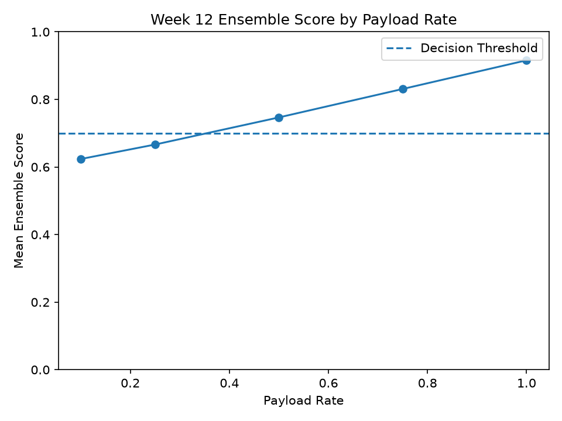
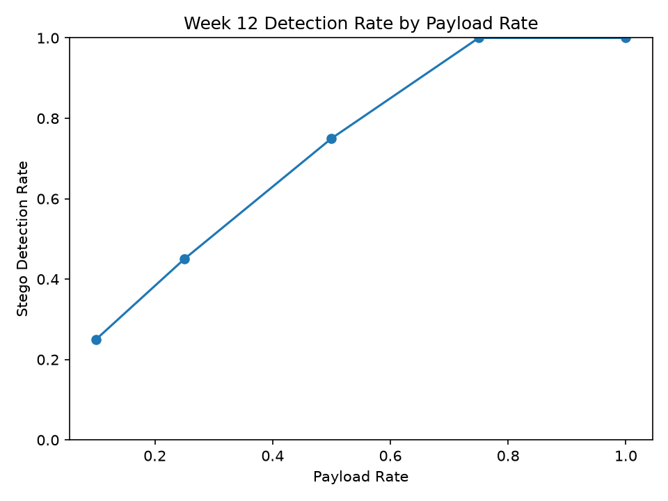
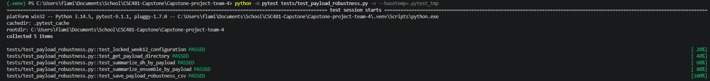
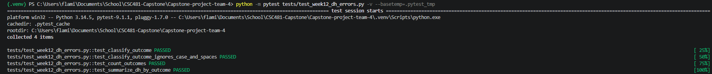

# Exzavier - Week 12 DH Error Analysis and Payload Robustness

## Scope and locked configuration

This is Exzavier's Week 12 Difference Histogram error-analysis and
payload-rate robustness contribution.

The Week 12 work has two goals:

1. Analyze Difference Histogram behavior across the Week 11 true-positive,
true-negative, false-positive, and false-negative results

2. Evaluate how the locked ensemble behaves as randomized LSB payload rate increases.

The locked ensemble configuration remains:

| **Setting** | **Locked value** |
| --- | ---: |
| Chi-square weight | 0.00 |
| RS weight | 0.70 |
| Difference Histogram weight | 0.30 |
| Decision threshold | 0.70 |

No detector algorithm, normalization rule, weight, or threshold is changed during Week 12.

The primary evaluation scripts are:

```
src/evaluation/analyze_week12_dh_errors.py
src/evaluation/run_payload_robustness.py
```

## DH error-case analysis

The DH error analysis uses the official Week 11 held-out prediction file:

```
data/week11_heldout_predictions.csv
```

The file contains `40` held-out results.

The Week 12 analysis separates the rows into:

```
TP = True Positive
TN = True Negative
FP = False Positive
FN = False Negative
```

The reproduced Week 11 outcome counts are:

| **Outcome** | **Count** |
| --- | ---: |
| TP | 9 |
| TN | 16 |
| FP | 4 |
| FN | 11 |

For each outcome group, the analysis calculates the count, mean, median, minimum, and maximum `normalized_dh` score.

| **Outcome** | **Count** | **Mean normalized DH** | **Median** | **Minimum** | **Maximum** |
| --- | ---: | ---: | ---: | ---: | ---: |
| TP | 9 | 0.743258 | 0.742986 | 0.556927 | 0.843522 |
| TN | 16 | 0.635069 | 0.659188 | 0.409410 | 0.797036 |
| FP | 4 | 0.779769 | 0.797879 | 0.680659 | 0.842657 |
| FN | 11 | 0.649792 | 0.677748 | 0.463471 | 0.759373 |

The true-positive group has a higher mean normalized DH score than the false-negative group:

```
TP = 0.743258
FN = 0.649792
```

This shows that successfully detected stego images tended to have higher DH suspiciousness than missed stego images.

The false-positive group also has a higher mean normalized DH score than the true-negative group:

```
FP = 0.779769
TN = 0.635069
```

This shows that some clean images can also receive high DH suspiciousness.

DH alone should not be treated as the cause of the final classification because the locked ensemble uses RS at `0.70` weight and DH at `0.30` weight.

## DH error-group plot

The Week 12 DH error-group plot compares mean normalized DH scores across TP, TN, FP, and FN cases.



The figure provides visual evidence of the differences between correctly and incorrectly classified clean and stego images.

## Payload-rate robustness experiment

The Week 12 payload experiment uses clean source images `081` through `100`.

Five randomized LSB payload rates are evaluated:

```
0.10
0.25
0.50
0.75
1.00
```

Each of the `20` clean source images is embedded at all five payload rates:

```
20 source images x 5 payload rates = 100 experimental stego images
```

The experimental images are stored separately from the official project stego dataset:

```
data/week12_payload_images/
    payload_010/
    payload_025/
    payload_050/
    payload_075/
    payload_100/
```

Each folder contains `20` experimental images.

Reproducible embedding seeds are used so the payload experiment can be repeated consistently.

## DH payload results

The existing Difference Histogram detector is applied to all `100` experimental stego images.

The mean normalized DH scores are:

| **Payload rate** | **Images** | **Mean normalized DH** |
| --- | ---: | ---: |
| 0.10 | 20 | 0.675666 |
| 0.25 | 20 | 0.691905 |
| 0.50 | 20 | 0.714105 |
| 0.75 | 20 | 0.728284 |
| 1.00 | 20 | 0.733350 |

Mean normalized DH suspiciousness increases at every tested payload rate:

```
0.10 -> 0.675666
0.25 -> 0.691905
0.50 -> 0.714105
0.75 -> 0.728284
1.00 -> 0.733350
```

This indicates that DH generally becomes more suspicious as more randomized LSB payload is embedded.

The DH payload plot is:



## Ensemble payload results

The same `100` experimental images are evaluated using the existing Chi-square, RS, and DH detectors with the locked ensemble configuration.

The results are:

| **Payload rate** | **Images** | **Mean ensemble score** | **Detected stego** | **Detection rate** |
| --- | ---: | ---: | ---: | ---: |
| 0.10 | 20 | 0.623654 | 5 / 20 | 25% |
| 0.25 | 20 | 0.666473 | 9 / 20 | 45% |
| 0.50 | 20 | 0.746737 | 15 / 20 | 75% |
| 0.75 | 20 | 0.830980 | 20 / 20 | 100% |
| 1.00 | 20 | 0.915777 | 20 / 20 | 100% |

The mean ensemble score increases as payload rate increases:

```
0.10 -> 0.623654
0.25 -> 0.666473
0.50 -> 0.746737
0.75 -> 0.830980
1.00 -> 0.915777
```

The detection rate also increases:

```
0.10 -> 25%
0.25 -> 45%
0.50 -> 75%
0.75 -> 100%
1.00 -> 100%
```

The lower payload rates are more difficult for the locked ensemble to detect, while all experimental stego images are detected at payload rates `0.75` and `1.00`.

The ensemble-score plot is:



The detection-rate plot is:



Because all `100` images in the payload experiment are stego images, these percentages are stego detection rates rather than overall classification accuracy.

## CSV output

The Week 12 per-image robustness results are stored in:

```
data/week12_payload_robustness.csv
```

The CSV contains `100` rows and includes detector scores, normalized scores, ensemble scores, predictions, expected labels, and correctness results.

The script verifies the CSV after writing it.

The completed verification reports:

```
Week 12 robustness CSV verified.
CSV rows: 100
```

## Testing

The payload-robustness tests are located in:

```
tests/test_payload_robustness.py
```

The tests verify:

- Locked payload rates, weights, and threshold;
- Payload-directory naming;
- DH summary calculations;
- Ensemble summary and detection-rate calculations; and
- CSV writing using temporary pytest storage.

Run the tests with:

```
python -m pytest tests/test_payload_robustness.py -v --basetemp=.pytest_tmp
```

The payload-robustness tests pass.



The DH error-analysis tests are located in:

```
tests/test_week12_dh_errors.py
```

The tests verify:

- TP, TN, FP, and FN classification;
- Case-insensitive label handling;
- Outcome counting; and
- DH mean, median, minimum, and maximum calculations.

Run the tests with:

```
python -m pytest tests/test_week12_dh_errors.py -v --basetemp=.pytest_tmp
```

The DH error-analysis tests pass.



## Interpretation

The Week 12 DH error analysis shows that correctly detected stego images had higher average DH suspiciousness than missed stego images.

It also shows that some clean images with high DH suspiciousness became false positives.

The payload-rate experiment shows a consistent increase in DH suspiciousness and locked-ensemble score as randomized LSB payload increases.

The ensemble detection rate rises from `25%` at payload `0.10` to `100%` at payload `0.75` and `1.00`.

These results indicate that the locked statistical ensemble is more effective at detecting higher-payload randomized LSB steganography and has greater difficulty with lower-payload steganography.

## Work boundaries

No detector algorithms are modified during this Week 12 contribution.

No new weights or thresholds are selected.

The official Week 11 predictions and metrics are not changed.

The Week 12 experimental images do not replace the official project stego dataset.

Arthur's Chi-square and RS detectors are used only as existing dependencies when calculating the locked ensemble.

Menishen's locked ensemble configuration remains unchanged.

The Week 12 results provide DH error-analysis and payload-robustness evidence for the team's final project evaluation.