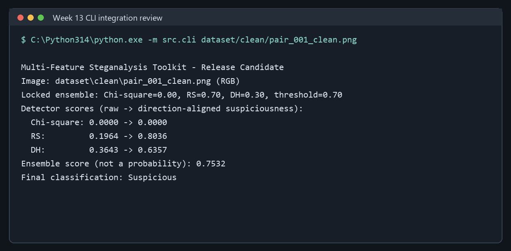
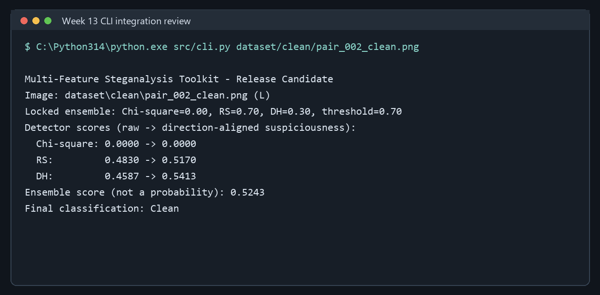

# Week 13: Arthur's CLI integration review

**Review status:** Complete for the CLI integration scope.
**Suggested caption:** Arthur Week 13 – CLI integration, detector parity, and user-error handling test evidence.

## Command reviewed

```text
python -m src.cli dataset/clean/pair_001_clean.png
python src/cli.py dataset/clean/pair_002_clean.png
```

The CLI merged to `main` calls the existing detectors and passes their raw scores to `combine_detector_scores()` with `LOCKED_CONFIG` from the Week 11 evaluation runner. The locked weights are Chi-square `0.00`, RS `0.70`, DH `0.30`; threshold `0.70`. The label boundary remains inclusive: a score greater than or equal to `0.70` is Suspicious. This review adds a direct-script import fix and makes unexpected detector failures print a concise error rather than a traceback.

## Verification

`tests/test_cli_integration.py` compares all three CLI detector outputs against direct detector calls on the same loaded image, and compares the CLI ensemble score and label to `combine_detector_scores()`. It verifies the locked weights and threshold, both sides of the threshold boundary, grayscale and RGB inputs, both invocation forms, missing paths, unsupported or unreadable inputs, and detector failures.

Both documented invocation forms were executed from the repository root. The module command produced a Suspicious result (`0.7532`) for `pair_001_clean.png`; direct script invocation produced a Clean result (`0.5243`) for `pair_002_clean.png`. These labels reflect detector outputs and the locked threshold, not dataset ground truth.

Command run:

```text
python -m pytest -q tests/test_cli_integration.py
9 passed
```

The focused CLI test run did not modify detector algorithms, preprocessing, normalization, voting, the Week 10 locked configuration, or Week 11 held-out metrics. The CLI reports existing detector scores directly; it does not add a scoring formula. Ordinary file and image errors return concise argparse errors without tracebacks.

## Evidence





Example output from the checked-in dataset sample:

```text
Ensemble score (not a probability): 0.7532
Final classification: Suspicious
```

This is the detector classification, not ground truth. The toolkit is non-machine-learning and is intended primarily for statistical LSB steganalysis. It does not detect every steganography method; Week 12 observations showed weaker performance at lower payload rates. A score is not universal proof that hidden data is present.
