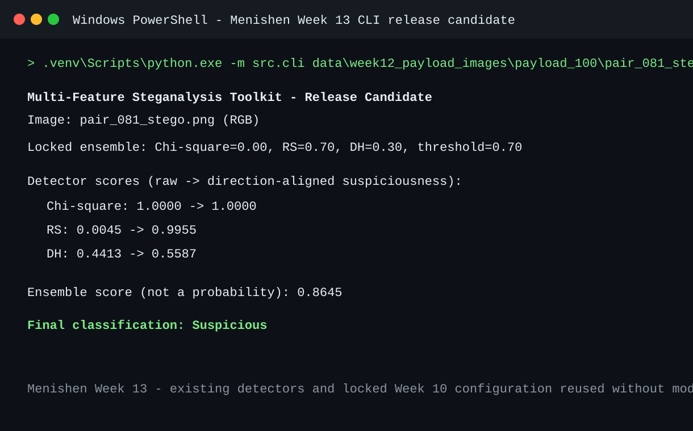

# Menishen Week 13 - Release-Candidate CLI

## Scope

Menishen implemented the release-candidate command-line interface in
`src/cli.py`. It accepts one image path, applies the existing project image
preprocessing and all three existing statistical detectors, then combines their
scores with the locked Week 10 configuration.

The interface does not alter detector formulas, preprocessing, normalization,
weights, threshold, or the immutable Week 11 held-out metrics.

## Command

From the repository root on Windows:

```powershell
.venv\Scripts\python.exe -m src.cli path\to\image.png
```

The CLI also provides built-in command help:

```powershell
.venv\Scripts\python.exe -m src.cli --help
```

## Locked configuration and output

The CLI imports the existing `LOCKED_CONFIG` used by the Week 11 held-out
runner. Its configuration is unchanged:

| Setting | Value |
| --- | ---: |
| Chi-square weight | `0.00` |
| RS weight | `0.70` |
| Difference Histogram weight | `0.30` |
| Decision threshold | `0.70` |

For each image, the output includes the raw detector scores, their existing
direction-aligned values, the ensemble score, and the final `Clean` or
`Suspicious` result. An ensemble score is a statistical suspiciousness score,
not a probability that hidden data is present.

Missing, unreadable, corrupt, or detector-incompatible images produce a concise
command-line error and a non-zero exit rather than a Python traceback.

## Handoff for Week 13 review

Arthur can exercise `src.cli.analyze_image()` and `format_analysis()` for
detector/ensemble parity and error-handling regression tests. Exzavier can use
the command above for the final README workflow and screenshots after the CLI
review is complete.



*Menishen Week 13 - Release-candidate CLI successfully analyzing an image with
the locked ensemble configuration.*
