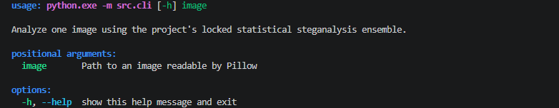
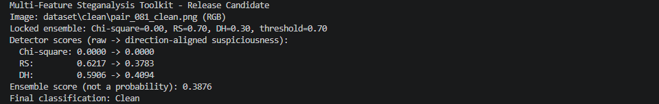
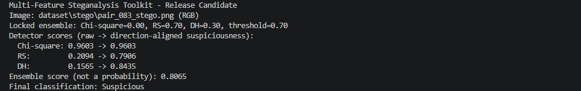

# Multi-Feature Steganalysis Toolkit CLI User Guide

## Purpose

This guide provides the user-facing workflow for operating the release-candidate command-line interface of the **Multi-Feature Steganalysis Toolkit**.

It assumes the project has already been installed and configured.

For project background, installation instructions, detector explanations, evaluation results, and detailed limitations, refer to the main `README.md`.

This guide focuses on:

- Viewing CLI help
- Analyzing an image
- Reviewing detector and ensemble output
- Interpreting the final classification
- Recognizing common CLI errors

---

## View CLI Help

From the repository root, run:

```
python -m src.cli --help
```

The help output shows the required image-path argument and basic CLI usage.



**Figure 1. Release-candidate CLI help output.**

---

## Analyze an Image

The CLI analyzes one image at a time.

Use:

```
python -m src.cli path/to/image.png
```

The CLI can also be run directly with:

```
python src/cli.py path/to/image.png
```

Replace:

```
path/to/image.png
```

with the actual path to the image being analyzed.

For example:

```
python -m src.cli dataset/clean/pair_081_clean.png
```

After the command is entered, the toolkit automatically runs the image through the existing preprocessing, detector, normalization, and ensemble pipeline.

The user does not need to run the Chi-square, RS, or Difference Histogram detectors separately.

The basic workflow is:

```
Choose image
    ↓
Run CLI
    ↓
Review detector scores
    ↓
Review ensemble score
    ↓
Read final classification
```

---

## Clean Example

Run:

```
python -m src.cli dataset/clean/pair_081_clean.png
```

This example uses a known clean held-out image.

The CLI reports:

```
Final classification: Clean
```

with an ensemble score of approximately:

```
0.3876
```



**Figure 2. Known clean image correctly classified as Clean.**

For this example:

```
Known image type:      Clean
Ensemble score:        approximately 0.3876
Final classification:  Clean
Outcome:               Correct
```

---

## Suspicious Example

Run:

```
python -m src.cli dataset/stego/pair_083_stego.png
```

This example uses a known randomized-LSB stego held-out image.

The CLI reports:

```
Final classification: Suspicious
```

with an ensemble score of approximately:

```
0.8065
```



**Figure 3. Known stego image correctly classified as Suspicious.**

For this example:

```
Known image type:      Stego
Ensemble score:        approximately 0.8065
Final classification:  Suspicious
Outcome:               Correct
```

---

## Reading the CLI Result

A successful analysis displays information similar to:

```
Multi-Feature Steganalysis Toolkit - Release Candidate

Image: path/to/image.png (RGB)

Locked ensemble: Chi-square=0.00, RS=0.70, DH=0.30, threshold=0.70

Detector scores (raw -> direction-aligned suspiciousness):
  Chi-square: 0.xxxx -> 0.xxxx
  RS:         0.xxxx -> 0.xxxx
  DH:         0.xxxx -> 0.xxxx

Ensemble score (not a probability): 0.xxxx
Final classification: Clean
```

The main information a user should identify is:

- Image being analyzed
- Chi-square score
- RS score
- Difference Histogram score
- Ensemble score
- Final classification

Each detector displays:

```
raw score -> direction-aligned suspiciousness
```

The CLI performs this conversion automatically.

The ensemble score is then used to produce the final result.

---

## Interpreting the Result

### Clean

A result of:

```
Final classification: Clean
```

means the ensemble score is below the project's decision threshold.

A Clean classification does not guarantee that the image contains no hidden information.

### Suspicious

A result of:

```
Final classification: Suspicious
```

means the ensemble score met or exceeded the project's decision threshold.

A Suspicious classification does not prove that hidden information exists.

The ensemble score is a statistical decision score and is not a probability.

---

## Common CLI Errors

### Incorrect Image Path

An incorrect path prevents the CLI from finding the image.

Example:

```
python -m src.cli does_not_exist.png
```

Check:

- The filename
- The file extension
- The folder path
- That the file exists
- That the terminal is open in the correct project directory

---

### Missing Image Path

Running:

```
python -m src.cli
```

without an image path does not perform an analysis.

Use:

```
python -m src.cli --help
```

to review the expected command syntax.

---

### Unreadable Image

If the selected image cannot be opened, verify that:

- The file exists
- The file is a valid image
- The image is not corrupted
- Pillow can read the image

---

### Wrong Working Directory

CLI commands should be run from the repository root.

The project root should contain items such as:

```
README.md
requirements.txt
src/
dataset/
docs/
tests/
```

If Python cannot locate the `src` package, verify that the terminal is open in the correct directory.

---

## Visual Evidence

The Week 13 user-facing screenshots are stored in:

```
docs/assets/week13-progress/
```

The evidence includes:

```
cli_help.png
clean_image_analysis.png
suspicious_image_analysis.png
```

These screenshots demonstrate:

1. CLI help being accessed successfully
2. A known clean image being analyzed successfully
3. A known stego image being analyzed successfully
4. Detector scores being displayed
5. The ensemble score being displayed
6. The final Clean or Suspicious classification being displayed

Together, the screenshots demonstrate the complete user-facing release-candidate workflow.

---

## Quick Reference

### View Help

```
python -m src.cli --help
```

### Analyze an Image

```
python -m src.cli path/to/image.png
```

### Clean Example

```
python -m src.cli dataset/clean/pair_081_clean.png
```

### Suspicious Example

```
python -m src.cli dataset/stego/pair_083_stego.png
```

---

## Week 13 Workflow Summary

```
Open repository
      ↓
Choose image
      ↓
Run CLI
      ↓
Review detector scores
      ↓
Review ensemble score
      ↓
Read Clean / Suspicious result
```

The Week 13 user guide and screenshots provide visual evidence that a user can successfully operate the release-candidate command-line interface.
