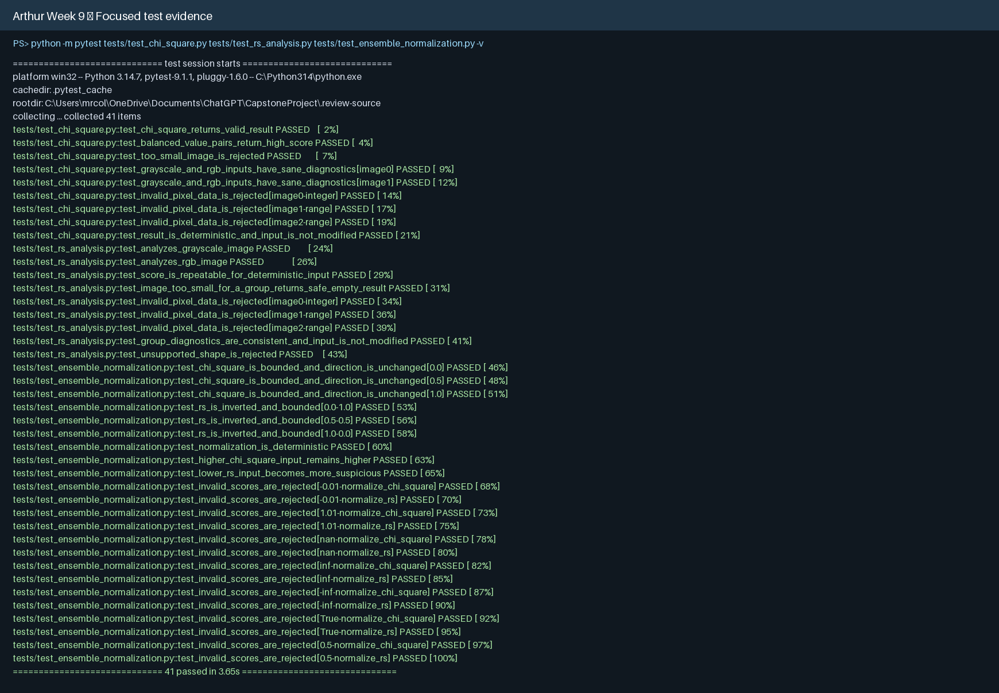
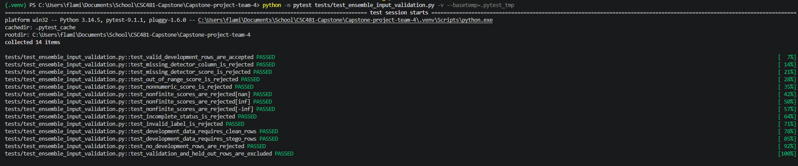
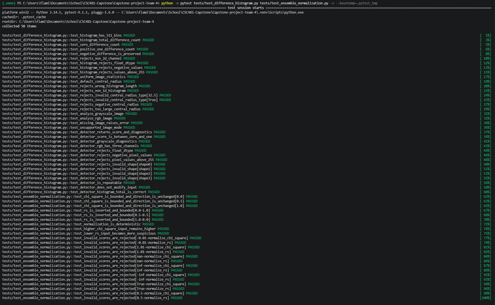

# Team 4 Week 9 Progress Report

## Multi-Feature Steganalysis Toolkit

**Team:** Afriyie Menishen (Team Leader), Arthur Coleman, and Exzavier Pickering  
**Reporting period:** Week 9  
**Planned milestone:** Implement a weighted-voting ensemble and reproducible
equal-weight baseline.

## 1. Milestone achieved

The team completed the Week 9 ensemble-baseline milestone. The repository now
contains an explainable weighted-voting module with a reproducible default
configuration. It combines the three existing detector scores only after their
directions are aligned with the common convention: a higher value means greater
suspicion.

The baseline assigns equal one-third weights to Chi-square, RS, and Difference
Histogram (DH), and reports `Suspicious` at a score of at least `0.50`;
otherwise it reports `Clean`. The baseline is explicitly marked as
uncalibrated. It is a repeatable starting point for the Week 10
development/validation calibration work, not a final classifier or probability
claim.

## 2. Subtasks completed and test evidence

### 2.1 Score-direction alignment — Arthur Coleman and Exzavier Pickering

Arthur prepared Chi-square and RS inputs for the ensemble. Chi-square retains
its existing bounded score; RS is inverted with `1 - raw_score` because the
Week 7 development-only review observed lower average RS values for stego
images. Exzavier applied the corresponding `1 - raw_score` transformation to
DH for the same common suspiciousness direction.

Both transformations validate that inputs are finite numeric values in
`[0, 1]`. The original detectors are not altered. This preserves their
diagnostics and makes the direction adjustment visible at the ensemble
boundary.

Arthur's focused tests cover endpoints, intermediate values, deterministic
behavior, range preservation, intended direction, and rejection of negative,
above-one, boolean, nonnumeric, `NaN`, and infinite values.



*Figure 1. Arthur's focused Chi-square, RS, and normalization tests pass.*

Exzavier's input-validation tests ensure that only structurally valid,
complete development rows are prepared for later ensemble work. They reject
missing required columns or scores, invalid labels/statuses, out-of-range,
nonnumeric, `NaN`, and infinite values; they also confirm that validation and
held-out rows are excluded from this development-input check.



*Figure 2. Exzavier's focused development-score input-validation tests pass.*

### 2.2 Equal-weight voting baseline — Afriyie Menishen

Menishen implemented `src/ensemble/voting.py`. The module accepts named
Chi-square, RS, and DH scores, aligns their directions, applies configured
weights, and returns an auditable result containing:

- raw detector scores;
- direction-aligned detector scores;
- normalized weights and each weighted contribution;
- ensemble score, threshold, and configuration name;
- a `Clean` or `Suspicious` baseline label; and
- a `calibrated: false` marker.

The default `EQUAL_WEIGHT_BASELINE` uses weights of one third each and threshold
`0.50`. `EnsembleConfig` rejects invalid thresholds and weights, including
negative, non-finite, or non-normalizing values. The voting tests check equal
weighting, score calculation, the inclusive threshold boundary, deterministic
custom configurations, missing scores, invalid score inputs, and explanatory
result fields.

The combined focused Week 9 verification command was:

```powershell
.venv\Scripts\python.exe -m pytest tests/test_ensemble_normalization.py tests/test_ensemble_input_validation.py tests/test_ensemble_voting.py -v
```



*Figure 3. Week 9 score-direction verification evidence. The voting module is
tested alongside the validated normalized inputs.*

### 2.3 Dataset metadata integrity correction — Afriyie Menishen

During integrated verification, the team found that the clean-image filenames
had been renumbered while 50 metadata `color_mode` values still reflected the
former filename convention. Menishen corrected those metadata values and
updated the DH dataset mode test to compare each file against its metadata row
rather than an assumed filename range. This is a dataset-integrity correction;
it does not change detector algorithms, pixel data, or split assignments.

The complete test suite passed **191 tests** after the correction. The run
confirms the ensemble work, existing detector tests, dataset checks, and the
metadata-driven regression test operate together.

## 3. Lessons learned

- Detector scores may share the same numeric range while pointing in different
  directions; direction alignment must be explicit before weighted voting.
- An ensemble score should expose raw inputs, transformations, weights, and
  contributions so a classification can be reviewed rather than treated as a
  black box.
- A reproducible equal-weight model is useful as a baseline, but it must not be
  presented as calibrated accuracy or a final operating threshold.
- Metadata-based validation is more robust than relying on filename sequences,
  which can change as a dataset is regenerated or reordered.
- The held-out test split must remain protected while development and validation
  evidence are used for the Week 10 calibration work.

## 4. Contributions of each team member

| Team member | Week 9 contribution |
| --- | --- |
| **Afriyie Menishen — Team Leader** | Implemented the explainable weighted-voting module and equal-weight baseline; added voting tests and documentation; corrected color-mode metadata and made the DH mode regression test metadata-driven; integrated and verified the full suite; maintained the Week 9 meeting record. |
| **Arthur Coleman — Member A** | Documented and tested Chi-square/RS score-direction compatibility; retained Chi-square direction and inverted RS for common ensemble suspiciousness input. |
| **Exzavier Pickering — Member B** | Documented and tested DH score-direction compatibility; inverted DH at the ensemble boundary and added development-score input validation. |
| **All members** | Reviewed the shared suspiciousness convention, preserved data-split safeguards, and confirmed that calibration remains deferred to the planned Week 10 workflow. |

## 5. Progress against the plan

The team is on schedule for the Week 9 milestone: an ensemble module with a
reproducible configuration is available. No schedule adjustment is required.

The team intentionally did **not** select final weights, a final threshold, or
performance metrics in Week 9. In accordance with the approved project plan,
Week 10 will perform a reproducible grid search using development and
validation data. The held-out test split will remain unused until the planned
final evaluation stage.

## 6. Supporting evidence

- [Approved project plan](../project-plan.md)
- [Menishen's Week 9 ensemble baseline](week9-menishen-ensemble-baseline.md)
- [Arthur's Week 9 score-direction documentation](week9-arthur-score-direction.md)
- [Exzavier's Week 9 DH score-direction documentation](week9-dh-score-direction.md)
- [Week 9 meeting minutes](../minutes/week9_meeting_minutes.md)
