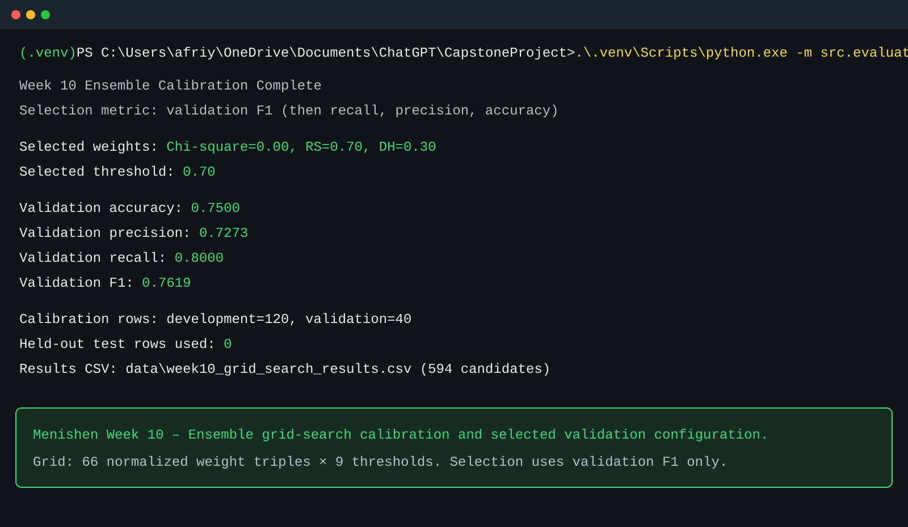
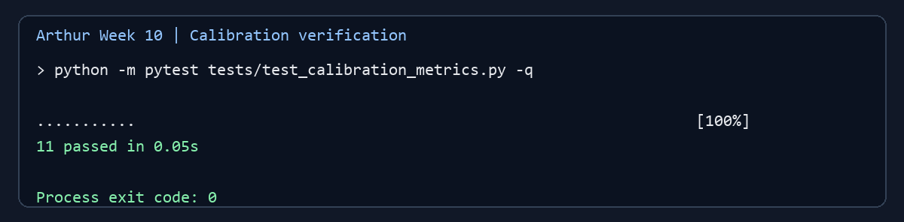

# Team 4 Week 10 Progress Report

## Multi-Feature Steganalysis Toolkit

**Team:** Afriyie Menishen (Team Leader), Arthur Coleman, and Exzavier Pickering  
**Reporting period:** Week 10  
**Planned milestone:** Run a reproducible grid search for ensemble weights and
the decision threshold using the development and validation splits; retain the
held-out test split for Week 11.

## 1. Milestone achieved

The team completed the Week 10 calibration milestone. A reproducible search
evaluated 594 candidate ensemble configurations using only the approved
development and validation data. The resulting selected configuration uses a
Chi-square weight of `0.00`, an RS weight of `0.70`, a Difference Histogram
(DH) weight of `0.30`, and a decision threshold of `0.70`.

Selection was based on validation F1, fixed before the result was inspected.
The selected validation result is accuracy `0.7500`, precision `0.7273`,
recall `0.8000`, and F1 `0.7619`. These are validation-calibration results,
not final project-performance claims. The held-out test split was not read,
scored, plotted, or used to select the configuration.

## 2. Subtasks completed and test evidence

### 2.1 Reproducible ensemble grid search — Afriyie Menishen

Menishen implemented `src/evaluation/grid_search_ensemble.py`, which filters
metadata to the `development` and `validation` splits before images are loaded.
It evaluates all non-negative three-detector weight triples in increments of
`0.10` that sum to `1.00` (66 combinations) across thresholds from `0.30` to
`0.70` in increments of `0.05` (9 values). The resulting `66 × 9 = 594`
configurations are written to `data/week10_grid_search_results.csv`.

The runner uses the Week 9 direction alignment at the ensemble boundary:
Chi-square is retained, while RS and DH are inverted so that higher ensemble
inputs consistently mean greater suspicion. The selection rule maximizes
validation F1. Ties are resolved only with validation recall, precision,
accuracy, threshold distance from `0.50`, and then a deterministic weight
ordering. Development metrics are stored for transparency but never choose or
break ties between configurations.

The seven focused grid-search tests verify weight and threshold grids,
positive-class metric calculation, one selected result, held-out-row rejection,
CSV output structure, and completion output. The generated evidence below
records 120 development rows, 40 validation rows, and zero held-out rows.



*Figure 1. Menishen's calibration run selects the validation-only
configuration and records the search size and protected held-out count.*

### 2.2 Calibration and selection safeguards — Arthur Coleman

Arthur added an independent calibration-verification layer in
`src/evaluation/calibration_metrics.py`. It checks the binary metrics with
stego as the positive class; rejects invalid thresholds, scores, and weights;
applies the inclusive `score >= threshold` rule; and verifies that a selected
configuration actually appears in the grid-search result table. It also rejects
non-validation rows from validation-metric inputs, including held-out rows.

Arthur's focused tests include a hand-calculated classification example
(`TP=1`, `TN=2`, `FP=0`, `FN=1`), zero-division cases, threshold-boundary
behavior, RS direction handling, invalid weights, selected-row membership, and
held-out split rejection. This is an independent safeguard for the calibration
workflow; it does not run a competing search or alter detector algorithms.



*Figure 2. Arthur's focused calibration-verification tests pass, including
validation-only and selected-configuration safeguards.*

### 2.3 Validation plots and baseline comparison — Exzavier Pickering

Exzavier implemented `src/evaluation/plot_calibration.py` and the associated
tests. The plotting workflow reads the completed grid-search CSV, requires the
expected validation columns, and finds the one configuration already marked as
selected. It does not conduct another search or choose a new threshold.

Three validation-only visualizations were produced:

- validation F1 across thresholds for the selected weights;
- validation accuracy across the same thresholds; and
- an equal-weight baseline comparison against the selected configuration.

The plot tests check valid and malformed CSV inputs, exactly one selected row,
selected-weight filtering and threshold ordering, image creation for all three
plots, and validation-only baseline metrics. Development and held-out records
are excluded from the baseline comparison.


*Figure 3. Exzavier's focused validation-plot tests pass. The plots support the
already selected validation configuration without re-tuning it.*

### 2.4 Integrated verification

After installing the declared plotting dependency, the full repository suite
was executed from the merged Week 10 `main` revision:

```powershell
.venv\Scripts\python.exe -m pip install -r requirements.txt
.venv\Scripts\python.exe -m pytest -q -p no:cacheprovider
```

The result was **218 passing tests**. This verifies the Week 10 grid search,
calibration safeguards, and plotting workflow alongside the earlier detector,
embedding, dataset, preprocessing, and ensemble tests.

## 3. Lessons learned

- Weight and threshold selection must be reproducible and driven by the
  validation split, not by the held-out test results.
- Recording every candidate configuration makes calibration auditable and
  allows the selected result to be verified rather than manually asserted.
- Validation plots should illustrate a selection already made by the documented
  rule; they should not be used to silently tune a second time.
- Independent checks for metrics, threshold boundaries, and split membership
  provide useful protection against calibration mistakes.
- New runtime dependencies must be listed in `requirements.txt` and installed
  before integrated tests are run.

## 4. Contributions of each team member

| Team member | Week 10 contribution |
| --- | --- |
| **Afriyie Menishen — Team Leader** | Built the reproducible development/validation-only grid-search runner; generated the 594-row result table; documented the selected configuration and validation metrics; preserved the held-out split; and completed integrated verification. |
| **Arthur Coleman — Member A** | Implemented independent calibration metric, threshold, weight, selected-row, and validation-split safeguards with focused tests and evidence. |
| **Exzavier Pickering — Member B** | Implemented validation F1/accuracy plots and the equal-weight baseline comparison; added validation-only plotting tests, plot documentation, artifacts, and the Matplotlib dependency declaration. |
| **All members** | Reviewed the selected configuration, preserved the split-protection rule, and agreed that held-out performance evaluation remains deferred to Week 11. |

## 5. Progress against the plan

The team is on schedule for the Week 10 milestone. The selected weights and
threshold are documented, reproducible, and based on development/validation
evidence only. No schedule adjustment is required.

In accordance with the project plan, the team did not produce final held-out
metrics, ROC curves, AUC, confusion matrices, or final accuracy in Week 10.
Those tasks remain scheduled for Week 11, where the selected Week 10
configuration will be evaluated once on the protected held-out test split.

## 6. Supporting evidence

- [Approved project plan](../../project-plan.md)
- [Menishen's Week 10 calibration results](../week10-calibration-results.md)
- [Arthur's Week 10 calibration verification](../week10-arthur-calibration-verification.md)
- [Exzavier's Week 10 validation plots](../week10-validation-plots.md)
- [Complete Week 10 grid-search results](../../data/week10_grid_search_results.csv)
