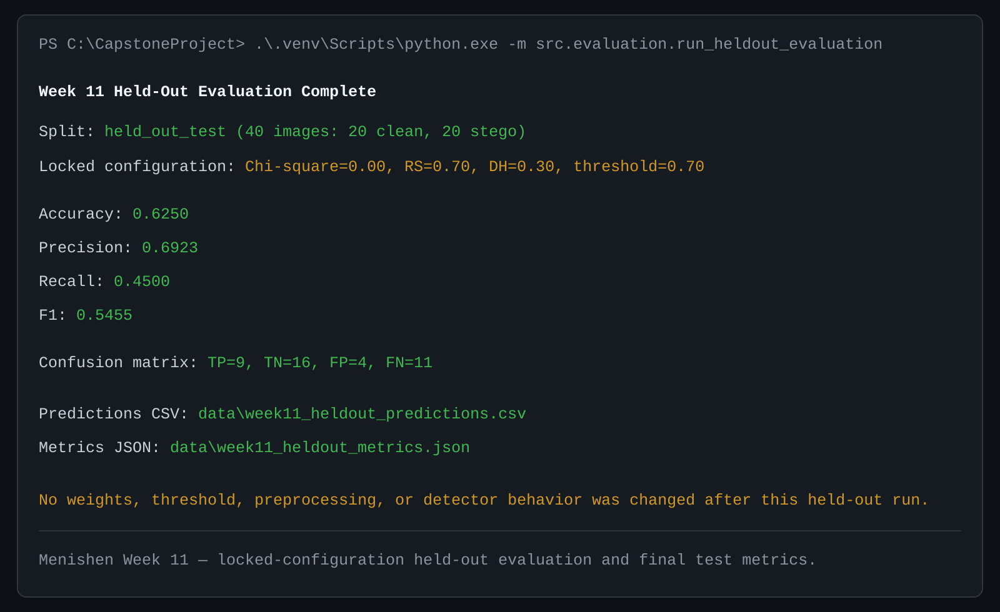
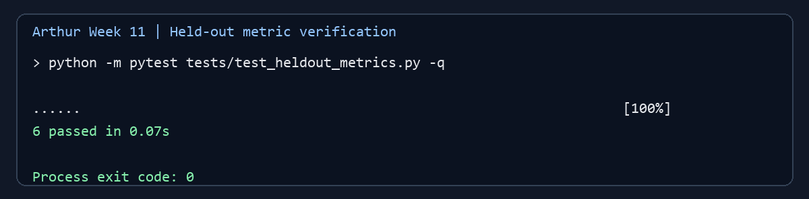
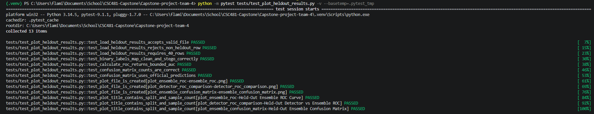

# Team 4 Week 11 Progress Report

## Multi-Feature Steganalysis Toolkit

**Team:** Afriyie Menishen (Team Leader), Arthur Coleman, and Exzavier Pickering  
**Reporting period:** Week 11  
**Planned milestone:** Run the first and only held-out evaluation using the
locked Week 10 configuration; report accuracy, precision, recall, F1, ROC,
AUC, and confusion-matrix results.

## 1. Milestone achieved

The team completed the Week 11 held-out evaluation milestone. The evaluation
uses the protected `held_out_test` split: 20 clean images and their 20 matched
LSB-stego images, for 40 images from 20 source-image pairs. The Week 10
configuration remained locked throughout the work: Chi-square weight `0.00`,
RS weight `0.70`, Difference Histogram (DH) weight `0.30`, and decision
threshold `0.70`.

The final results, recorded without retuning, are accuracy `0.6250`, precision
`0.6923`, recall `0.4500`, and F1 `0.5455`. The confusion matrix is TP `9`,
TN `16`, FP `4`, and FN `11`. The held-out ROC/AUC results are Chi-square
`0.5475`, RS `0.6850`, DH `0.5875`, and ensemble `0.6675`.

## 2. Subtasks completed and test evidence

### 2.1 Official locked held-out evaluation — Afriyie Menishen

Menishen implemented `src/evaluation/run_heldout_evaluation.py` and generated
the official prediction and metric artifacts. The runner reads only
`held_out_test` metadata rows, requires exactly 20 source pairs, applies the
existing Week 9 score-direction normalization and voting logic, and writes
`data/week11_heldout_predictions.csv` and
`data/week11_heldout_metrics.json`. It refuses to overwrite these official
outputs, preventing an accidental second run at the same paths.

The focused evaluation tests cover the locked weights and threshold,
held-out-only input selection, required pair count, prediction structure,
official voting boundary, accuracy/precision/recall/F1 and confusion-count
calculation, rejection of non-held-out rows, and output-overwrite protection.
The focused Week 11 evaluation and locked-configuration tests passed **34
tests**.



*Figure 1. Menishen's official held-out run: 40 protected images, locked
configuration, final metrics, and confusion counts.*

### 2.2 Independent metrics and prediction verification — Arthur Coleman

Arthur implemented `src/evaluation/heldout_metrics.py`, an independent verifier
that consumes the official CSV and JSON without loading images, rerunning
detectors, changing scores, or tuning the configuration. It checks the 20
unique held-out sources, one clean and one stego row per source, locked
configuration values, Week 9-normalized scores, ensemble-score and prediction
parity, metric arithmetic, and the final confusion matrix.

Arthur's six focused tests use hand-checkable and synthetic paired examples to
cover all four confusion-matrix cells, 40-row paired structure, invalid source
IDs, changed thresholds, incorrect ensemble scores, and incorrect summary
counts. The verifier also passed against the official result files and
reproduced TP `9`, TN `16`, FP `4`, FN `11`, accuracy `0.6250`, precision
`0.6923`, recall `0.4500`, and F1 `0.5455`.



*Figure 2. Arthur's focused independent held-out verification tests passing.*

### 2.3 Held-out ROC/AUC and confusion-matrix plots — Exzavier Pickering

Exzavier implemented `src/evaluation/plot_heldout_results.py`, which consumes
the official prediction table and validates that all 40 rows belong to
`held_out_test`. It generates the ensemble ROC curve, detector-versus-ensemble
ROC comparison, and ensemble confusion matrix. ROC uses the continuous
direction-aligned scores; the confusion matrix uses Menishen's official
prediction column. The workflow does not search for another threshold or
modify the locked configuration.

The focused plotting tests cover valid 40-row inputs, rejection of the wrong
split or row count, clean/stego label conversion, ROC/AUC bounds, confusion
matrix layout and totals, preservation of the official predictions, plot
creation, and split/sample-size labels. The plot documentation records the
four held-out AUC values and the final confusion matrix.



*Figure 3. Exzavier's focused plotting tests passing for held-out ROC/AUC and
confusion-matrix output.*

### 2.4 Integrated audit

The merged result artifacts were checked for 40 rows, 20 clean labels, 20
stego labels, only `held_out_test` membership, and exactly two rows per source
identifier. The recorded metrics and confusion matrix agree across Menishen's
official runner, Arthur's independent verifier, and Exzavier's visualizations.

`scikit-learn` is declared in `requirements.txt` for the plotting workflow.
Install declared dependencies before running the complete suite:

```powershell
.venv\Scripts\python.exe -m pip install -r requirements.txt
.venv\Scripts\python.exe -m pytest -q -p no:cacheprovider
```

## 3. Lessons learned

- The held-out set must be used only after weights and threshold are locked;
  lower recall is an evaluation finding, not a reason to retune Week 10.
- Independent verification is more reliable when it reuses the documented
  normalization and voting functions rather than re-implementing them.
- Pair-level checks are needed in addition to row counts to prove that every
  clean/stego source pair remains within the reserved split.
- ROC/AUC measures continuous-score ranking, while the confusion matrix reports
  performance at the locked `0.70` decision threshold; neither should silently
  change the other.
- Runtime dependencies for visualizations must be recorded and installed before
  the full test suite is run.

## 4. Contributions of each team member

| Team member | Week 11 contribution |
| --- | --- |
| **Afriyie Menishen — Team Leader** | Ran the official one-time locked held-out evaluation; implemented the guarded runner and tests; recorded predictions, metrics, reproducibility documentation, and evidence. |
| **Arthur Coleman — Member A** | Implemented the independent metric, configuration, score-parity, and confusion-matrix verifier; added focused tests and evidence; confirmed the official results without rerunning detectors. |
| **Exzavier Pickering — Member B** | Implemented the held-out ROC/AUC and confusion-matrix plotting workflow; added input-protection and plotting tests; produced the comparison and final evaluation plots. |
| **All members** | Reviewed the locked-configuration safeguard, the paired held-out split, and the recorded results without adjusting weights, threshold, preprocessing, or detector behavior. |

## 5. Progress against the plan

The team is on schedule for the Week 11 milestone. The plan requires final
metrics tables and plots from the held-out split, and these are present with a
consistent 40-image evaluation population. No schedule adjustment is required.

The observed recall and false-negative count will be treated as inputs to the
planned Week 12 error-case and robustness investigation. The Week 10
configuration remains fixed; no held-out result will be used to recalibrate it.

## 6. Supporting evidence

- [Approved project plan](../../project-plan.md)
- [Official held-out evaluation](../week11-heldout-evaluation.md)
- [Arthur's independent verification](../week11-arthur-heldout-verification.md)
- [Exzavier's held-out plots](../week11-heldout-plots.md)
- [Official prediction table](../../data/week11_heldout_predictions.csv)
- [Official metrics JSON](../../data/week11_heldout_metrics.json)
