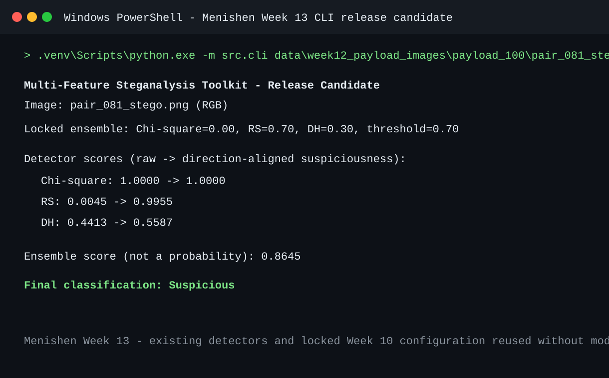
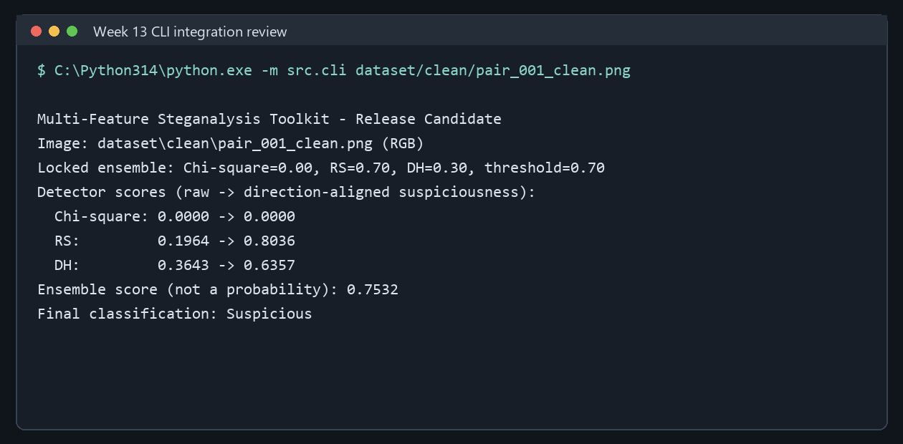
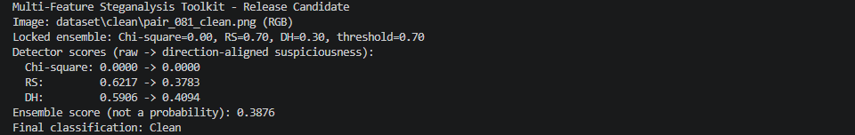

# Team 4 Week 13 Progress Report

## Multi-Feature Steganalysis Toolkit

**Team:** Afriyie Menishen (Team Leader), Arthur Coleman, and Exzavier Pickering  
**Reporting period:** Week 13  
**Planned milestone:** Deliver a usable release candidate by polishing the CLI,
validating its integration behavior, and preparing user documentation.

## 1. Milestone achieved

The team completed the Week 13 release-candidate milestone. A user can run the
CLI on one image, view the three detector scores and their direction-aligned
values, see the ensemble score, and receive a `Clean` or `Suspicious` result.
The interface uses the existing locked configuration: Chi-square `0.00`, RS
`0.70`, DH `0.30`, and threshold `0.70`.

No detector logic, preprocessing rule, normalization rule, ensemble weight,
decision threshold, or official Week 11 result was changed for the interface.

## 2. Completed work and verification

### 2.1 Menishen — Release-candidate CLI

Menishen implemented `src/cli.py`. The supported command is:

```powershell
.venv\Scripts\python.exe -m src.cli path\to\image.png
```

The CLI reuses `load_image()`, the existing Chi-square, RS, and DH detectors,
`combine_detector_scores()`, and the existing `LOCKED_CONFIG`. It displays raw
and direction-aligned scores, the locked weights and threshold, the ensemble
score, and a final classification. A missing or unreadable input produces a
concise non-zero command-line error rather than a traceback.



*Figure 1. Menishen Week 13 — release-candidate CLI successfully analyzing an
RGB image with the locked ensemble configuration.*

### 2.2 Arthur — CLI parity and regression review

Arthur added `tests/test_cli_integration.py` and completed the CLI
integration review. The tests compare CLI output with direct detector calls and
the existing ensemble function for both grayscale and RGB images. They verify
the locked weights and `0.70` inclusive decision boundary, module and direct
script invocation, missing paths, corrupt or unsupported inputs, and detector
failure handling. The focused CLI integration suite passed **9 tests**.



*Figure 2. Arthur Week 13 — CLI integration, detector parity, and user-error
handling evidence.*

### 2.3 Exzavier — User workflow and optional GUI

Exzavier completed the user-facing README and `docs/week13-user-guide.md`.
They document purpose, requirements, installation, CLI usage, supported image
handling, example output, score interpretation, and limitations. The guide
includes help, clean-analysis, and suspicious-analysis screenshots.

Exzavier also delivered the optional `src/gui.py`, which reuses the CLI
analysis pipeline to provide image selection, analysis, final classification,
ensemble score, threshold, and all three detector-score displays. The GUI
formatting test passes without changing detector or ensemble behavior.



*Figure 3. Exzavier Week 13 — documented release-candidate workflow showing a
successful clean-image CLI analysis.*

### 2.4 Merged-main verification

The merged main branch was verified with the Week 13 CLI/GUI tests and existing
ensemble, normalization, and held-out-configuration regressions:

```powershell
python -m pytest tests/test_cli_integration.py tests/test_gui.py `
  tests/test_ensemble_voting.py tests/test_ensemble_normalization.py `
  tests/test_heldout_evaluation.py -q
```

**Result: 72 passed.** This confirms that the release interface did not change
the locked voting behavior or the Week 11 evaluation configuration.

## 3. Contributions of each team member

| Team member | Week 13 contribution |
| --- | --- |
| **Afriyie Menishen — Team Leader** | Implemented and documented the release-candidate CLI, preserved the locked ensemble integration, and completed final integration verification. |
| **Arthur Coleman — Member A** | Added CLI detector-parity, threshold-boundary, supported-mode, and error-handling regression coverage with review evidence. |
| **Exzavier Pickering — Member B** | Completed README and user-guide documentation, CLI workflow screenshots, and the optional GUI with formatting coverage. |
| **All members** | Confirmed the final interface is explainable, uses the locked configuration, and does not replace the official Week 11 findings. |

## 4. Progress against the plan

The Week 13 usable release-candidate milestone is complete. The project is
ready for Week 14 final-report drafting. The final report must clearly separate
the locked Week 11 held-out findings from the descriptive Week 12 robustness
work and preserve the documented limitations of statistical LSB steganalysis.

## 5. Supporting evidence

- [Menishen's Week 13 CLI documentation](../week13-menishen-cli.md)
- [Arthur's Week 13 CLI review](../week13-arthur-cli-review.md)
- [Exzavier's Week 13 user guide](../week13-user-guide.md)
- [README installation and usage guide](../../README.md)
- [Week 13 meeting minutes](../../minutes/week13_meeting_minutes.md)
